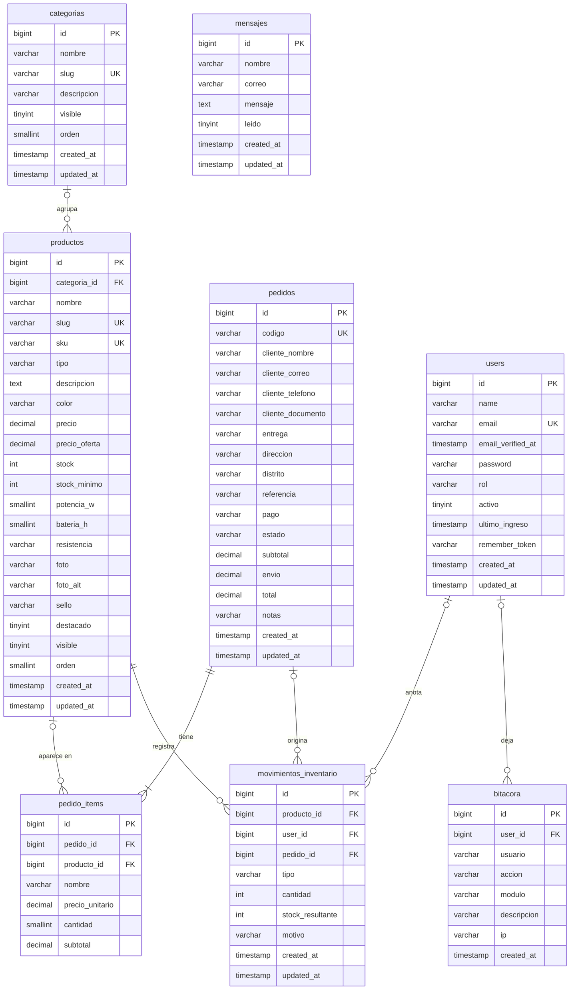

# Tercer avance: incidentes, CI/CD y nube

Guía del equipo para completar el tercer avance de JBL Web. Cada punto dice qué archivo del repositorio lo cubre y qué pasos hay que hacer a mano en GitHub, Jenkins y Vercel.

## Datos del proyecto

| Dato | Valor |
|------|-------|
| Nombre | JBL Web: tienda de demostración con ERP |
| Descripción | Tienda de demostración de la marca JBL (catálogo de 26 productos, carrito, pedido y seguimiento) y un ERP en Laravel para administrar productos, categorías, inventario, pedidos, mensajes y usuarios, con tres roles y bitácora. Proyecto académico no oficial: no cobra ni envía nada |
| Stack | HTML5, CSS3 y JavaScript sin framework (tienda) · Laravel 12 sobre PHP 8.2 con vistas Blade (ERP) |
| Base de datos | MySQL / MariaDB, base `jbl_erp`: 16 tablas (8 del negocio y 8 de Laravel) |
| Pruebas | 46 pruebas automáticas del ERP (`php artisan test`) y un script que verifica la tienda (`node scripts/verificar-landing.mjs`) |
| Repositorio | https://github.com/Dietri-Diaz/jbl-web |
| Nube | Vercel: https://jbl-web-ebon.vercel.app |

Los valores marcados con **[EDITAR]** son datos de cada cuenta (tokens, usuario de Jenkins, dominio de ngrok) o fechas del sílabo. El tablero Kanban está en https://github.com/users/Dietri-Diaz/projects/1.

---

## 1. GitHub Projects (tablero Kanban)

### Columnas

| Columna | Qué significa | Cuándo entra una tarjeta |
|---------|---------------|--------------------------|
| Backlog | Pendiente, nadie lo empezó | Al crear el issue |
| En progreso | Alguien lo trabaja en su rama | Al crear la rama |
| En revisión | Hay un pull request abierto | Al abrir el pull request |
| Hecho | Fusionado en `main` y con el issue cerrado | Al cerrarse el issue |

### Tarjetas

Cada tarjeta es un issue del punto 4. Los issues #20 a #24 ya existen en el repositorio; los siete restantes los crea `trabajo/seguimiento-issues.sh` y recibirán los números #26 a #32 si nadie abre otro issue o pull request antes.

| N.º | Título | Descripción | Responsable | Columna inicial |
|-----|--------|-------------|-------------|-----------------|
| #26 | Las pruebas del ERP fallan: la raíz responde 302 y la prueba espera 200 | La prueba de ejemplo de Laravel falla y pone en rojo cualquier pipeline | Dietri-Diaz | En revisión |
| #27 | La landing publicada intenta conectarse a 127.0.0.1:8000 | En un sitio publicado, el navegador del visitante buscaría el ERP en su propia máquina | Dietri-Diaz | En revisión |
| #30 | Agregar database/schema.sql y el diccionario de datos | Script SQL con las 16 tablas, datos de ejemplo y documentación del modelo | Anto-Jaimes | En revisión |
| #28 | Configurar la integración continua con Jenkins | Jenkins en Docker, `Jenkinsfile` con cuatro etapas y workflow de GitHub Actions | jorgeo26 | En progreso |
| #29 | Desplegar la landing en Vercel desde Jenkins | Etapa Deploy con el token guardado en Jenkins Credentials | Alba-devjxt | En progreso |
| #22 | Completar la documentación del ERP en docs | Llevar a la wiki el modelo de datos, la API y la instalación | Anto-Jaimes | En progreso |
| #24 | Agregar descripción y topics al repositorio | Completar el About con la descripción, los topics y el enlace de Vercel | Dietri-Diaz | Backlog |
| #20 | Optimizar y comprimir las imágenes de assets/img | Las imágenes pesan 2,1 MB; comprimirlas o pasarlas a WebP | Alba-devjxt | Backlog |
| #21 | Revisar que la landing se vea bien en celular | Revisión manual entre 320 y 480 px de las 6 páginas de la tienda: menú, catálogo, carrito y formularios | Anto-Jaimes | Backlog |
| #23 | Revisar los datos de la carpeta data | Comparar las fichas técnicas del catálogo (`data/catalogo.js`, que se genera desde el ERP) con las fichas oficiales | jorgeo26 | Backlog |
| #31 | Convertir la landing en una tienda con carrito y pedidos | Catálogo con filtros, ficha de producto, carrito, pago y seguimiento del pedido | Dietri-Diaz | En revisión |
| #32 | Ampliar el ERP: categorías, inventario, pedidos, roles y bitácora | Productos con precio y stock, categorías, inventario, pedidos con estados, tres roles y bitácora | Dietri-Diaz | En revisión |

Las tres primeras y las dos últimas empiezan en «En revisión» porque su solución ya está escrita y solo falta el pull request. Los responsables son una propuesta: se cambian en las primeras líneas del script.

### Pasos para crear el tablero

1. Ejecutar primero `bash trabajo/seguimiento-issues.sh` (punto 4) para que existan los doce issues.
2. En GitHub, entrar al repositorio → pestaña **Projects** → **Link a project** → **New project**.
3. Elegir la plantilla **Board**, nombrarlo `JBL Web: tercer avance` y pulsar **Create project**.
4. El tablero trae tres columnas (Todo, In Progress, Done). En cada una, menú de tres puntos → **Edit details**, y renombrarlas a `Backlog`, `En progreso` y `Hecho`.
5. Pulsar **+ New column** a la derecha, nombrarla `En revisión` y arrastrarla entre `En progreso` y `Hecho`.
6. Agregar los issues: en la parte inferior de `Backlog`, pulsar **+ Add item**, escribir `#`, elegir el repositorio `jbl-web` y marcar los doce issues.
7. Arrastrar cada tarjeta a la columna de la tabla anterior.
8. Automatizar: menú de tres puntos del proyecto → **Workflows**:
   - **Auto-add to project**: activar con el filtro `is:issue` para el repositorio `jbl-web`. Cada issue nuevo entra solo al tablero.
   - **Item closed**: activar con Status = `Hecho`. Al cerrarse un issue, su tarjeta pasa sola a «Hecho».
   - **Pull request merged**: activar con Status = `Hecho`.
9. Dar acceso al equipo: menú de tres puntos → **Settings** → **Manage access** → invitar a `jorgeo26`, `Alba-devjxt` y `Anto-Jaimes` con rol **Write**.
10. Hacerlo visible para la docente: **Settings** → **Visibility** → **Public**.
11. Copiar la dirección del tablero en la página Home de la wiki, donde dice [EDITAR].

Cada tarjeta queda vinculada a su issue: al abrirla se ven la descripción, las etiquetas, el milestone, el responsable y los pull requests enlazados.

---

## 2. Base de datos

### Modelo entidad-relación

La base `jbl_erp` tiene 16 tablas: 8 del negocio y 8 que administra Laravel. Entre las tablas del negocio hay 7 claves foráneas.

- **users**: las personas que entran al panel, cada una con su rol (`admin`, `editor` o `lector`).
- **categorias**: los grupos en que se ordena el catálogo.
- **productos**: lo que vende la tienda, con su precio, su oferta, su stock, su ficha técnica y su foto.
- **pedidos**: cada compra hecha en la tienda, con los datos del cliente, la entrega, el pago, el estado y los totales.
- **pedido_items**: el detalle de cada pedido: qué producto, a qué precio y cuántas unidades.
- **movimientos_inventario**: el historial del stock: entradas, salidas, ajustes, ventas y devoluciones.
- **mensajes**: lo que los visitantes envían desde el formulario de contacto.
- **bitacora**: el registro de lo que hace cada usuario en el panel.

Relaciones (todas de uno a muchos):

| Relación | Clave foránea | Si se elimina el padre |
|----------|---------------|------------------------|
| Una categoría agrupa muchos productos | `productos.categoria_id` → `categorias.id` | `SET NULL` |
| Un pedido tiene muchas líneas | `pedido_items.pedido_id` → `pedidos.id` | `CASCADE` |
| Un producto aparece en muchas líneas de pedido | `pedido_items.producto_id` → `productos.id` | `SET NULL` |
| Un producto tiene muchos movimientos de inventario | `movimientos_inventario.producto_id` → `productos.id` | `CASCADE` |
| Un usuario registra muchos movimientos | `movimientos_inventario.user_id` → `users.id` | `SET NULL` |
| Un pedido origina muchos movimientos | `movimientos_inventario.pedido_id` → `pedidos.id` | `SET NULL` |
| Un usuario tiene muchos registros en la bitácora | `bitacora.user_id` → `users.id` | `SET NULL` |

`mensajes` no se relaciona con ninguna tabla, porque los escriben visitantes sin cuenta. `pedidos` tampoco se relaciona con `users`: los clientes de la tienda no se registran y sus datos van en el propio pedido. La línea del pedido guarda una copia del nombre y del precio del producto, para que el pedido no cambie si después se edita o se elimina el producto.

Las 8 tablas de Laravel son `migrations`, `password_reset_tokens`, `sessions`, `cache`, `cache_locks`, `jobs`, `job_batches` y `failed_jobs`. No tienen claves foráneas y no aparecen en el diagrama.



### Script

Archivo: [`database/schema.sql`](../database/schema.sql). Crea la base, las 16 tablas con sus claves primarias, índices únicos y las 7 claves foráneas, y carga los datos de ejemplo: 3 usuarios (uno por rol, contraseña `admin123`), 5 categorías, 26 productos, 22 pedidos con su detalle y sus movimientos de inventario, 5 mensajes y la bitácora. De las tablas de Laravel solo `migrations` lleva datos; las demás las llena el framework mientras la aplicación está en uso.

```bash
mysql -u root -p < database/schema.sql
```

El archivo se genera con `mysqldump` desde una base recién migrada y sembrada, así que equivale a ejecutar `php artisan migrate --seed` dentro de `erp/`. No conviene editarlo a mano. Borra y vuelve a crear las tablas de `jbl_erp`.

Se probó en MariaDB 10.4.32 (la de XAMPP): carga sin errores.

Los modelos y las fotografías de los productos son reales; los precios, el stock, los clientes y los pedidos son inventados para la demostración.

### Diccionario de datos

El diccionario completo de las 16 tablas está en [`docs/wiki/Base-de-datos.md`](wiki/Base-de-datos.md). Estas son las ocho tablas del negocio:

| Tabla | Campo | Tipo | Restricción | Descripción |
|-------|-------|------|-------------|-------------|
| users | id | BIGINT UNSIGNED | PK, autoincremental | Identificador del usuario |
| users | name | VARCHAR(255) | NOT NULL | Nombre que se muestra en el panel |
| users | email | VARCHAR(255) | NOT NULL, UNIQUE | Correo con el que inicia sesión |
| users | email_verified_at | TIMESTAMP | NULL | Fecha en que se verificó el correo (no se usa) |
| users | password | VARCHAR(255) | NOT NULL | Contraseña cifrada con bcrypt |
| users | rol | VARCHAR(20) | NOT NULL, DEFAULT 'admin' | Rol en el panel: `admin`, `editor` o `lector` |
| users | activo | TINYINT(1) | NOT NULL, DEFAULT 1 | 1 si puede ingresar, 0 si la cuenta está desactivada |
| users | ultimo_ingreso | TIMESTAMP | NULL | Fecha de su último inicio de sesión |
| users | remember_token | VARCHAR(100) | NULL | Token de la opción «recordarme» |
| users | created_at | TIMESTAMP | NULL | Fecha de creación |
| users | updated_at | TIMESTAMP | NULL | Fecha de la última modificación |
| categorias | id | BIGINT UNSIGNED | PK, autoincremental | Identificador de la categoría |
| categorias | nombre | VARCHAR(60) | NOT NULL | Nombre, por ejemplo «Parlantes portátiles» |
| categorias | slug | VARCHAR(70) | NOT NULL, UNIQUE | Nombre para direcciones, por ejemplo `parlantes-portatiles` |
| categorias | descripcion | VARCHAR(200) | NULL | Texto breve que acompaña a la categoría en la tienda |
| categorias | visible | TINYINT(1) | NOT NULL, DEFAULT 1 | 1 si se muestra en la tienda, 0 si está oculta |
| categorias | orden | SMALLINT UNSIGNED | NOT NULL, DEFAULT 0 | Posición en la tienda, de menor a mayor |
| categorias | created_at | TIMESTAMP | NULL | Fecha de creación |
| categorias | updated_at | TIMESTAMP | NULL | Fecha de la última modificación |
| productos | id | BIGINT UNSIGNED | PK, autoincremental | Identificador del producto |
| productos | categoria_id | BIGINT UNSIGNED | NULL, FK a `categorias.id` (ON DELETE SET NULL) | Categoría a la que pertenece |
| productos | nombre | VARCHAR(80) | NOT NULL | Nombre comercial, por ejemplo «JBL Go 4» |
| productos | slug | VARCHAR(90) | NOT NULL, UNIQUE | Nombre para direcciones y archivos, por ejemplo `go-4` |
| productos | sku | VARCHAR(30) | NULL, UNIQUE | Código interno del producto, por ejemplo `JBL-GO4-MO` |
| productos | tipo | VARCHAR(40) | NOT NULL | Tipo de producto, por ejemplo «Ultra compacto» |
| productos | descripcion | TEXT | NULL | Texto de la ficha del producto |
| productos | color | VARCHAR(30) | NULL | Color del modelo |
| productos | precio | DECIMAL(8,2) | NOT NULL, DEFAULT 0.00 | Precio normal en soles |
| productos | precio_oferta | DECIMAL(8,2) | NULL | Precio de oferta; NULL si no está en oferta |
| productos | stock | INT UNSIGNED | NOT NULL, DEFAULT 0 | Unidades disponibles |
| productos | stock_minimo | INT UNSIGNED | NOT NULL, DEFAULT 5 | Desde cuántas unidades el panel avisa «stock bajo» |
| productos | potencia_w | SMALLINT UNSIGNED | NULL | Potencia en vatios |
| productos | bateria_h | SMALLINT UNSIGNED | NULL | Duración de la batería en horas |
| productos | resistencia | VARCHAR(10) | NULL | Grado de protección, por ejemplo IPX7 o IP67 |
| productos | foto | VARCHAR(255) | NULL | Ruta de la foto dentro de `public/` |
| productos | foto_alt | VARCHAR(160) | NULL | Texto alternativo de la foto (accesibilidad) |
| productos | sello | VARCHAR(30) | NULL | Texto que destaca la tarjeta del producto |
| productos | destacado | TINYINT(1) | NOT NULL, DEFAULT 0 | 1 si aparece en los destacados del inicio |
| productos | visible | TINYINT(1) | NOT NULL, DEFAULT 1 | 1 si se publica en la tienda, 0 si está oculto |
| productos | orden | SMALLINT UNSIGNED | NOT NULL, DEFAULT 0 | Posición en la tienda, de menor a mayor |
| productos | created_at | TIMESTAMP | NULL | Fecha de creación |
| productos | updated_at | TIMESTAMP | NULL | Fecha de la última modificación |
| pedidos | id | BIGINT UNSIGNED | PK, autoincremental | Identificador del pedido |
| pedidos | codigo | VARCHAR(20) | NOT NULL, UNIQUE | Código que recibe el cliente, por ejemplo `JBL-000007` |
| pedidos | cliente_nombre | VARCHAR(80) | NOT NULL | Nombre del cliente |
| pedidos | cliente_correo | VARCHAR(120) | NOT NULL, índice | Correo del cliente; se pide para el seguimiento |
| pedidos | cliente_telefono | VARCHAR(20) | NOT NULL | Celular del cliente |
| pedidos | cliente_documento | VARCHAR(15) | NULL | DNI o RUC (opcional) |
| pedidos | entrega | VARCHAR(20) | NOT NULL | Forma de entrega: `delivery` (a domicilio) o `recojo` (en tienda) |
| pedidos | direccion | VARCHAR(160) | NULL | Dirección de entrega; NULL si es recojo en tienda |
| pedidos | distrito | VARCHAR(60) | NULL | Distrito de entrega; NULL si es recojo en tienda |
| pedidos | referencia | VARCHAR(160) | NULL | Referencia para ubicar la dirección |
| pedidos | pago | VARCHAR(20) | NOT NULL | Forma de pago: `contraentrega`, `yape` o `transferencia` |
| pedidos | estado | VARCHAR(20) | NOT NULL, DEFAULT 'pendiente', índice | `pendiente`, `confirmado`, `enviado`, `entregado` o `cancelado` |
| pedidos | subtotal | DECIMAL(10,2) | NOT NULL | Suma de las líneas del pedido |
| pedidos | envio | DECIMAL(8,2) | NOT NULL, DEFAULT 0.00 | Costo del envío |
| pedidos | total | DECIMAL(10,2) | NOT NULL | Subtotal más envío |
| pedidos | notas | VARCHAR(300) | NULL | Indicaciones del cliente |
| pedidos | created_at | TIMESTAMP | NULL | Fecha en que se hizo el pedido |
| pedidos | updated_at | TIMESTAMP | NULL | Fecha de la última modificación |
| pedido_items | id | BIGINT UNSIGNED | PK, autoincremental | Identificador de la línea |
| pedido_items | pedido_id | BIGINT UNSIGNED | NOT NULL, FK a `pedidos.id` (ON DELETE CASCADE) | Pedido al que pertenece |
| pedido_items | producto_id | BIGINT UNSIGNED | NULL, FK a `productos.id` (ON DELETE SET NULL) | Producto comprado; NULL si el producto se eliminó |
| pedido_items | nombre | VARCHAR(80) | NOT NULL | Nombre del producto al momento de la compra |
| pedido_items | precio_unitario | DECIMAL(8,2) | NOT NULL | Precio de cada unidad al momento de la compra |
| pedido_items | cantidad | SMALLINT UNSIGNED | NOT NULL | Unidades compradas |
| pedido_items | subtotal | DECIMAL(10,2) | NOT NULL | Precio unitario por cantidad |
| movimientos_inventario | id | BIGINT UNSIGNED | PK, autoincremental | Identificador del movimiento |
| movimientos_inventario | producto_id | BIGINT UNSIGNED | NOT NULL, FK a `productos.id` (ON DELETE CASCADE) | Producto cuyo stock cambió |
| movimientos_inventario | user_id | BIGINT UNSIGNED | NULL, FK a `users.id` (ON DELETE SET NULL) | Usuario que lo registró; NULL si lo generó la tienda |
| movimientos_inventario | pedido_id | BIGINT UNSIGNED | NULL, FK a `pedidos.id` (ON DELETE SET NULL) | Pedido que lo originó, en ventas y devoluciones |
| movimientos_inventario | tipo | VARCHAR(20) | NOT NULL, índice | `entrada`, `salida`, `ajuste`, `venta` o `devolucion` |
| movimientos_inventario | cantidad | INT | NOT NULL | Unidades que cambiaron: positiva si entran, negativa si salen |
| movimientos_inventario | stock_resultante | INT UNSIGNED | NOT NULL | Stock del producto después del movimiento |
| movimientos_inventario | motivo | VARCHAR(160) | NULL | Explicación, por ejemplo «Stock inicial» o «Pedido JBL-000007» |
| movimientos_inventario | created_at | TIMESTAMP | NULL | Fecha del movimiento |
| movimientos_inventario | updated_at | TIMESTAMP | NULL | Fecha de la última modificación |
| mensajes | id | BIGINT UNSIGNED | PK, autoincremental | Identificador del mensaje |
| mensajes | nombre | VARCHAR(80) | NOT NULL | Nombre de quien escribe |
| mensajes | correo | VARCHAR(120) | NOT NULL | Correo para responderle |
| mensajes | mensaje | TEXT | NOT NULL | Texto del mensaje (la API exige entre 10 y 1000 caracteres) |
| mensajes | leido | TINYINT(1) | NOT NULL, DEFAULT 0 | 1 si ya se leyó en el panel |
| mensajes | created_at | TIMESTAMP | NULL | Fecha en que llegó |
| mensajes | updated_at | TIMESTAMP | NULL | Fecha de la última modificación |
| bitacora | id | BIGINT UNSIGNED | PK, autoincremental | Identificador del registro |
| bitacora | user_id | BIGINT UNSIGNED | NULL, FK a `users.id` (ON DELETE SET NULL) | Usuario que hizo la acción |
| bitacora | usuario | VARCHAR(80) | NOT NULL | Nombre del usuario al momento de la acción |
| bitacora | accion | VARCHAR(20) | NOT NULL, índice | `ingresar`, `salir`, `crear`, `editar`, `eliminar`, `estado` o `stock` |
| bitacora | modulo | VARCHAR(30) | NOT NULL, índice | Módulo del panel, por ejemplo `pedidos` o `productos` |
| bitacora | descripcion | VARCHAR(255) | NOT NULL | Qué se hizo, por ejemplo «Pasó el pedido JBL-000001 a Entregado» |
| bitacora | ip | VARCHAR(45) | NULL | Dirección IP desde la que se hizo |
| bitacora | created_at | TIMESTAMP | NULL, índice | Fecha de la acción |

---

## 3. Wiki del proyecto

Las siete páginas están redactadas en [`docs/wiki/`](wiki/), con los nombres de archivo que GitHub espera:

| Página | Archivo | Contenido |
|--------|---------|-----------|
| Home | `Home.md` | Qué es el proyecto, enlaces, equipo y versiones |
| Arquitectura | `Arquitectura.md` | Partes, diagrama, los dos modos de la tienda (con ERP o con la copia estática), API y decisiones |
| Instalación y ejecución | `Instalacion-y-ejecucion.md` | Requisitos, pasos y problemas frecuentes |
| Base de datos | `Base-de-datos.md` | Modelo entidad-relación y diccionario de las 16 tablas |
| Flujo de trabajo | `Flujo-de-trabajo.md` | Ramas, paso a paso y convención de commits |
| CI/CD | `CI-CD.md` | Etapas, pruebas, Jenkins, credenciales y webhook |
| Despliegue | `Despliegue.md` | Qué se publica, previews, producción y vuelta atrás |
| (menú lateral) | `_Sidebar.md` | Índice que aparece en todas las páginas |

### Pasos para publicarla

La wiki de GitHub es un repositorio aparte que solo existe después de crear la primera página.

1. En GitHub: pestaña **Wiki** → **Create the first page** → **Save page** (el contenido da igual, se reemplaza).
2. Desde una carpeta **fuera** del repositorio:

   ```bash
   git clone https://github.com/Dietri-Diaz/jbl-web.wiki.git
   cp jbl-web/docs/wiki/*.md jbl-web.wiki/
   cd jbl-web.wiki
   git add .
   git commit -m "docs: publica las páginas de la wiki"
   git push
   ```

3. Abrir la pestaña **Wiki** y comprobar que el menú lateral muestra las siete páginas y que los diagramas se dibujan.
4. Cuando existan la dirección de Vercel y la del tablero, reemplazar los [EDITAR] de `Home.md` y `Despliegue.md` y volver a publicar.

---

## 4. Seguimiento de incidentes (GitHub Issues)

Todo este punto se aplica con un solo comando, desde la raíz del repositorio:

```bash
bash trabajo/seguimiento-issues.sh
```

### Etiquetas

| Etiqueta | Color | Uso |
|----------|-------|-----|
| `bug` | `#D73A4A` | Algo no funciona como debería |
| `mejora` | `#A2EEEF` | Función nueva o cambio que mejora lo existente |
| `documentación` | `#0075CA` | README, wiki, informe o comentarios del código |
| `urgente` | `#B60205` | Bloquea al equipo o a la página publicada |
| `base-de-datos` | `#5319E7` | Tablas, migraciones, datos de prueba o `schema.sql` |
| `ci-cd` | `#FBCA04` | Jenkins, GitHub Actions, Docker o despliegue en Vercel |

### Plantillas

- [`.github/ISSUE_TEMPLATE/bug.md`](../.github/ISSUE_TEMPLATE/bug.md): descripción, pasos para reproducir, resultado esperado y actual, dónde ocurre y gravedad.
- [`.github/ISSUE_TEMPLATE/mejora.md`](../.github/ISSUE_TEMPLATE/mejora.md): qué se propone, por qué, cómo y criterios de aceptación.

Cuando estén en `main`, el botón **New issue** mostrará las dos opciones.

### Milestones

| Milestone | Fecha límite | Contenido |
|-----------|--------------|-----------|
| Tercer avance: CI/CD y nube | [EDITAR] 22/11/2026 | Seguimiento de incidentes, integración continua, entrega continua y despliegue en Vercel |
| Entrega final (semana 18) | [EDITAR] 06/12/2026 | Pulido de la landing, documentación completa y exposición |

Las fechas se cambian en las variables `M1_FECHA` y `M2_FECHA` del script.

### Issues nuevos

**1. [BUG] Las pruebas del ERP fallan: la raíz responde 302 y la prueba espera 200**

- **Descripción:** `php artisan test` termina en rojo. La prueba de ejemplo de Laravel pide la raíz del ERP y espera un 200, pero la raíz redirige a `/panel`. Mientras falle, el pipeline no puede pasar.
- **Pasos para reproducir:** entrar a `erp/` → `composer install` → `php artisan test` → ver `Tests\Feature\ExampleTest`.
- **Resultado actual:** `Expected response status code [200] but received 302`.
- **Etiquetas:** `bug`, `urgente` · **Milestone:** Tercer avance · **Responsable:** Dietri-Diaz
- **Solución:** `erp/tests/Feature/ExampleTest.php` corregida: ahora comprueba la redirección al panel, que el panel exige iniciar sesión y que el login carga. Se agregaron `ApiLandingTest.php` (la API) y `PanelTest.php` (el panel). Resultado: `php artisan test` pasa con 46 pruebas y 333 aserciones.

**2. [BUG] La landing publicada intenta conectarse a 127.0.0.1:8000**

- **Descripción:** en la versión 1.2.0, `js/catalogo-erp.js` y `js/contacto.js` usaban `http://127.0.0.1:8000` como dirección del ERP si la página no traía `data-erp`. En un sitio publicado, el navegador del visitante intentaría conectarse a su propia máquina.
- **Pasos para reproducir:** abrir la landing desde una dirección pública → herramientas de desarrollo, pestaña Red → recargar y enviar el formulario.
- **Resultado actual:** petición fallida a `127.0.0.1:8000`, posible aviso de permiso de red local y formulario con «el servidor no responde».
- **Etiquetas:** `bug` · **Milestone:** Tercer avance · **Responsable:** Dietri-Diaz
- **Solución:** la dirección del ERP ahora se decide en un solo lugar, `js/tienda.js` (que reemplazó a `js/catalogo-erp.js` y a `js/main.js`): usa `127.0.0.1` solo si la página se abre en `localhost`, `127.0.0.1` o como archivo. En otro dominio solo usa `data-erp`; si no lo hay, la tienda trabaja con la copia estática `data/catalogo.js`.

**3. [MEJORA] Configurar la integración continua con Jenkins**

- **Descripción:** levantar Jenkins con Docker y agregar un `Jenkinsfile` con Checkout, Build, Test y Package, más un workflow de GitHub Actions para los pull requests.
- **Pasos para comprobarlo:** `docker compose -f jenkins/docker-compose.yml up -d --build` → crear el job → hacer un push → ver las cuatro etapas en verde.
- **Etiquetas:** `mejora`, `ci-cd` · **Milestone:** Tercer avance · **Responsable:** jorgeo26

**4. [MEJORA] Desplegar la landing en Vercel desde Jenkins**

- **Descripción:** agregar la etapa Deploy: cuando un cambio llega a `main` y las pruebas pasan, Jenkins publica la landing en Vercel con un token guardado en Jenkins Credentials.
- **Pasos para comprobarlo:** fusionar un pull request en `main` → ver la etapa Deploy en verde → abrir la dirección de Vercel.
- **Etiquetas:** `mejora`, `ci-cd` · **Milestone:** Tercer avance · **Responsable:** Alba-devjxt

**5. [MEJORA] Agregar database/schema.sql y el diccionario de datos**

- **Descripción:** script SQL con todas las tablas y datos de prueba, y documentación del modelo en la wiki.
- **Pasos para comprobarlo:** `mysql -u root -p < database/schema.sql` → comprobar las 16 tablas con 3 usuarios, 5 categorías, 26 productos, 22 pedidos y 5 mensajes.
- **Etiquetas:** `mejora`, `base-de-datos`, `documentación` · **Milestone:** Tercer avance · **Responsable:** Anto-Jaimes
- **Nota:** el texto del issue se escribió cuando la base tenía 10 tablas; las cifras de arriba son las actuales.

**6. [MEJORA] Convertir la landing en una tienda con carrito y pedidos**

- **Descripción:** pasar de una landing publicitaria a una tienda de demostración: catálogo con filtros, ficha de producto, carrito, pago y seguimiento del pedido. La tienda funciona con la copia estática del catálogo cuando el ERP no está disponible.
- **Pasos para comprobarlo:** encender el ERP (`php artisan serve`) y servir la tienda en el puerto 5500 → agregar productos al carrito y finalizar la compra → ver el pedido en el panel y seguirlo en `pedido.html` con su código y el correo.
- **Etiquetas:** `mejora` · **Milestone:** Entrega final (semana 18) · **Responsable:** Dietri-Diaz
- **Solución:** las 6 páginas de la tienda, `css/estilos.css`, los archivos de `js/` y `data/catalogo.js`.

**7. [MEJORA] Ampliar el ERP: categorías, inventario, pedidos, roles y bitácora**

- **Descripción:** ampliar el panel para administrar la tienda completa: productos con precio y stock, categorías, existencias y movimientos de inventario, pedidos con sus estados, usuarios con roles y bitácora de acciones.
- **Pasos para comprobarlo:** `php artisan migrate --seed` dentro de `erp/` → ingresar con `admin@jbl.pe` y recorrer cada módulo → cancelar un pedido y comprobar que su stock vuelve al inventario → ingresar con `consulta@jbl.pe` y comprobar que no puede modificar nada.
- **Etiquetas:** `mejora`, `base-de-datos` · **Milestone:** Entrega final (semana 18) · **Responsable:** Dietri-Diaz
- **Solución:** cinco migraciones nuevas, los módulos del panel, la API de pedidos y las pruebas automáticas, todo dentro de `erp/`.

### Issues que ya existían

Los abrió `jorgeo26` el 10/11/2026 sin etiquetas ni responsable. El script los clasifica así:

| N.º | Título | Etiqueta | Milestone | Responsable |
|-----|--------|----------|-----------|-------------|
| #20 | Optimizar y comprimir las imágenes de assets/img | `mejora` | Entrega final | Alba-devjxt |
| #21 | Revisar que la landing se vea bien en celular | `mejora` | Entrega final | Anto-Jaimes |
| #22 | Completar la documentación del ERP en docs | `documentación` | Tercer avance | Anto-Jaimes |
| #23 | Revisar los datos de la carpeta data | `mejora` | Entrega final | jorgeo26 |
| #24 | Agregar descripción y topics al repositorio | `documentación` | Tercer avance | Dietri-Diaz |

### Cerrar un issue desde un commit o un pull request

GitHub cierra un issue cuando encuentra una palabra clave seguida de su número: `Closes #n`, `Fixes #n` o `Resolves #n`.

Hay una condición que afecta a este proyecto: **el cierre ocurre cuando el cambio llega a la rama por defecto, que es `main`**. Como el equipo fusiona primero en `develop`, el issue no se cierra al fusionar la rama `feature/` o `bugfix/` en `develop`, sino después, al fusionar `develop` en `main`. Hasta entonces el issue muestra el enlace al commit y al pull request, pero sigue abierto.

Ejemplo con el issue #26:

```bash
git switch develop
git pull
git switch -c feature/erp-tienda

git add erp
git commit -m "feat: amplía el ERP con categorías, inventario, pedidos, roles y bitácora" -m "Incluye las pruebas del panel y de la API, y corrige la prueba de ejemplo." -m "Closes #26" -m "Closes #32"
git push -u origin feature/erp-tienda
```

Las pruebas corregidas viajan en la misma rama que el ERP ampliado porque dependen de ese código. Por eso el mismo commit cierra dos issues.

Al abrir el pull request hacia `develop`, se escribe en su descripción:

```
Amplía el ERP y deja las pruebas en verde (46 pruebas).

Closes #26
Closes #32
```

Qué se ve en GitHub:

1. En los issues #26 y #32 aparece «Dietri-Diaz mentioned this in commit …» y el enlace al pull request.
2. Al fusionar el pull request en `develop`, los issues siguen abiertos.
3. Al fusionar `develop` en `main`, los issues pasan a **Closed** con el texto «closed this as completed in …», y sus tarjetas se mueven a «Hecho».

Para enlazar sin cerrar (avances parciales) se usa `Refs #26`.

---

## 5. Integración continua con Jenkins

### Instalación con Docker

Requisito: **Docker Desktop** instalado y encendido (https://www.docker.com/products/docker-desktop). En Windows pide activar WSL 2 durante la instalación.

> **Estado al 16/11/2026.** Jenkins corre en el contenedor `jbl-jenkins` y el job `jbl-web` está creado. La ejecución n.º 1 pasó Checkout, Build, Test y Package; la n.º 2, sobre `main`, pasó además Deploy y publicó la tienda en Vercel. Falta el webhook con ngrok: por ahora las ejecuciones se lanzan con **Build Now**.

Los dos archivos están en la carpeta `jenkins/`:

- [`jenkins/Dockerfile`](../jenkins/Dockerfile): parte de `jenkins/jenkins:lts-jdk17` y agrega PHP (el de la imagen base, hoy 8.4) con sus extensiones (entre ellas GD, que las pruebas necesitan), Composer, Node.js 22, la CLI de Vercel y los plugins del pipeline.
- [`jenkins/docker-compose.yml`](../jenkins/docker-compose.yml): construye esa imagen, publica el puerto 8080 y guarda la configuración en el volumen `jenkins_home`.

Comandos, desde la raíz del repositorio:

```bash
# Construir la imagen y encender Jenkins (la primera vez tarda unos minutos)
docker compose -f jenkins/docker-compose.yml up -d --build

# Comprobar que está encendido
docker ps --filter name=jbl-jenkins

# Leer la contraseña inicial del administrador
docker exec jbl-jenkins cat /var/jenkins_home/secrets/initialAdminPassword

# Ver el registro si algo falla
docker logs -f jbl-jenkins

# Apagarlo (la configuración se conserva en el volumen)
docker compose -f jenkins/docker-compose.yml down
```

### Configuración inicial

1. Abrir http://localhost:8080 y pegar la contraseña inicial.
2. Elegir **Install suggested plugins** y esperar.
3. Crear el usuario administrador: [EDITAR: usuario y contraseña del equipo].
4. Dejar la dirección de Jenkins como `http://localhost:8080/` y terminar.

**Plugins.** El `Dockerfile` ya instala los que usa el pipeline. Se comprueban en **Manage Jenkins → Plugins → Installed plugins**:

| Plugin | Para qué |
|--------|----------|
| Pipeline (`workflow-aggregator`) | Leer el `Jenkinsfile` |
| Git | Clonar el repositorio |
| GitHub | Recibir el webhook y el disparador `githubPush()` |
| Credentials Binding | Entregar los secretos al pipeline sin mostrarlos |
| Pipeline: Stage View | Ver las etapas como columnas |
| Timestamper | Hora en cada línea de la consola |
| Workspace Cleanup | Limpiar la carpeta de trabajo al terminar |

**Credenciales de GitHub.**

1. En GitHub: foto de perfil → **Settings** → **Developer settings** → **Personal access tokens** → **Tokens (classic)** → **Generate new token (classic)**.
2. Nombre `jenkins-jbl`, vencimiento de 30 días y permiso **repo**. Pulsar **Generate token** y copiarlo: no se vuelve a mostrar.
3. En Jenkins: **Manage Jenkins → Credentials → System → Global credentials (unrestricted) → Add Credentials**.
4. Completar:
   - Kind: **Username with password**
   - Username: `Dietri-Diaz`
   - Password: el token copiado
   - ID: `github-jbl`
   - Description: `Token de GitHub para JBL Web`
5. Pulsar **Create**.

### Job tipo Pipeline desde SCM

1. En el inicio de Jenkins: **New Item**.
2. Nombre `jbl-web`, tipo **Pipeline**, **OK**.
3. En **General**: marcar **GitHub project** y escribir `https://github.com/Dietri-Diaz/jbl-web/`.
4. En **Build Triggers**: marcar **GitHub hook trigger for GITScm polling**.
5. En **Pipeline**:
   - Definition: **Pipeline script from SCM**
   - SCM: **Git**
   - Repository URL: `https://github.com/Dietri-Diaz/jbl-web.git`
   - Credentials: `github-jbl`
   - Branches to build: `*/main`. Pulsar **Add Branch** y agregar `*/develop`
   - Script Path: `Jenkinsfile`
6. **Save**.
7. Pulsar **Build Now** una vez. La primera ejecución manual es necesaria para que Jenkins registre el disparador del webhook.

### Webhook de GitHub hacia Jenkins con ngrok

GitHub no puede llegar a `localhost`, así que se abre un túnel.

1. Crear una cuenta gratuita en https://ngrok.com, descargar ngrok (en la computadora del equipo ya está instalado) y registrar el token de la cuenta:

   ```bash
   ngrok config add-authtoken [EDITAR: token de la cuenta de ngrok]
   ```

2. Abrir el túnel hacia Jenkins y dejar la ventana abierta:

   ```bash
   ngrok http 8080
   ```

3. Copiar la dirección `https://….ngrok-free.app` que aparece en **Forwarding**.
4. En GitHub: repositorio → **Settings** → **Webhooks** → **Add webhook**.
   - Payload URL: `https://[EDITAR: dominio de ngrok]/github-webhook/` (con la barra final)
   - Content type: `application/json`
   - Secret: vacío
   - Which events: **Just the push event**
   - Active: marcado
5. **Add webhook**. En la pestaña **Recent Deliveries** debe aparecer un `ping` con un check verde.
6. Probar: hacer un push a `develop` y ver que en Jenkins empieza una ejecución sola.

La dirección gratuita de ngrok cambia cada vez que se reinicia: hay que editar el webhook con la nueva.

### Jenkinsfile de integración continua

Versión con las cuatro etapas de integración. La versión final, con Deploy, está en el punto 6.

```groovy
pipeline {
    agent any

    options {
        timestamps()
        disableConcurrentBuilds()
        skipDefaultCheckout(true)
        buildDiscarder(logRotator(numToKeepStr: '15'))
    }

    triggers {
        githubPush()
    }

    environment {
        PAQUETE = "jbl-landing-${env.BUILD_NUMBER}.tar.gz"
    }

    stages {
        stage('Checkout') {
            steps {
                checkout scm
                sh 'git log -1 --format="Commit %h de %an: %s"'
            }
        }

        stage('Build') {
            steps {
                dir('erp') {
                    sh 'composer install --no-interaction --prefer-dist --no-progress'
                    sh 'cp .env.example .env'
                    sh 'php artisan key:generate --ansi'
                }
            }
        }

        stage('Test') {
            steps {
                sh 'node scripts/verificar-landing.mjs'
                dir('erp') {
                    sh 'php artisan test'
                }
            }
        }

        stage('Package') {
            steps {
                sh 'tar -czf "$PAQUETE" *.html css js assets data docs/creditos-imagenes.md'
                archiveArtifacts artifacts: "${env.PAQUETE}", fingerprint: true
            }
        }
    }

    post {
        success { echo 'Pipeline terminado sin errores.' }
        failure { echo 'El pipeline falló: revisa la etapa marcada en rojo.' }
        always  { cleanWs() }
    }
}
```

| Etapa | Qué hace |
|-------|----------|
| Checkout | Descarga el commit que disparó el pipeline y muestra su autor y mensaje |
| Build | Instala las dependencias del ERP con Composer y prepara el `.env` |
| Test | Verifica la tienda (enlaces de las 6 páginas, catálogo, fotos y sintaxis de JavaScript) y ejecuta las 46 pruebas del ERP sobre SQLite en memoria |
| Package | Empaqueta la tienda (`*.html`, `css`, `js`, `assets`, `data` y la página de créditos) en un `.tar.gz` y lo guarda como artefacto de la ejecución |

### Workflow de GitHub Actions

Además del `Jenkinsfile`, el repositorio incluye [`.github/workflows/ci.yml`](../.github/workflows/ci.yml). Repite Build y Test en la nube de GitHub en cada pull request, y cubre el ítem «ejemplo de workflow en `.github/workflows/`» de la rúbrica. No despliega: eso lo hace solo Jenkins.

---

## 6. Entrega continua con Jenkins hacia Vercel

### Jenkinsfile final

Archivo: [`Jenkinsfile`](../Jenkinsfile), en la raíz. Tiene las cinco etapas: **Checkout, Build, Test, Package y Deploy**. Respecto a la versión del punto 5 cambian dos cosas:

1. Checkout guarda la rama descargada en `env.RAMA`.
2. Se agrega la etapa Deploy, que solo corre en `main`:

```groovy
stage('Deploy') {
    when {
        expression { env.RAMA in ['main', 'origin/main'] }
    }
    environment {
        VERCEL_TOKEN      = credentials('vercel-token')
        VERCEL_ORG_ID     = credentials('vercel-org-id')
        VERCEL_PROJECT_ID = credentials('vercel-project-id')
    }
    steps {
        sh 'vercel deploy --prod --yes --token "$VERCEL_TOKEN" > url-despliegue.txt'
        sh 'echo "Landing publicada en: $(cat url-despliegue.txt)"'
        archiveArtifacts artifacts: 'url-despliegue.txt'
    }
}
```

### Cómo se protege el token

- El token **no está en el repositorio**. El `Jenkinsfile` solo menciona el ID `vercel-token`.
- `credentials('vercel-token')` lo entrega como variable de entorno únicamente dentro de la etapa Deploy.
- El comando usa comillas simples (`sh '... "$VERCEL_TOKEN"'`): la variable la resuelve la consola del contenedor, no Groovy, así que el valor no queda escrito en el registro.
- Si el valor llegara a aparecer en la consola, Jenkins lo reemplaza por `****`.
- La CLI lee `VERCEL_ORG_ID` y `VERCEL_PROJECT_ID` del entorno para saber a qué proyecto desplegar, sin necesidad de la carpeta `.vercel/`.

### Generar el token en Vercel

1. Entrar a https://vercel.com con la cuenta del equipo.
2. Foto de perfil → **Account Settings** → **Tokens**.
3. Nombre `jenkins-jbl`, Scope: la cuenta personal, Expiration: 30 días. Pulsar **Create**.
4. Copiar el token: no se vuelve a mostrar.

### Obtener los identificadores del proyecto

Después de importar el repositorio en Vercel (punto 7), desde la raíz del repositorio:

```bash
npm install --global vercel   # en la computadora del equipo ya está instalada (versión 65.16.0)
vercel login
vercel link
```

`vercel link` pregunta por la cuenta y el proyecto: elegir el proyecto `jbl-web` ya creado. Al terminar crea `.vercel/project.json` (está en `.gitignore`, no se sube):

```json
{ "orgId": "team_…", "projectId": "prj_…" }
```

### Registrar los secretos en Jenkins

En **Manage Jenkins → Credentials → System → Global credentials (unrestricted) → Add Credentials**, crear tres credenciales de tipo **Secret text**:

| ID | Secret | Description |
|----|--------|-------------|
| `vercel-token` | El token creado en Vercel | Token de Vercel para desplegar |
| `vercel-org-id` | El valor de `orgId` | Cuenta de Vercel |
| `vercel-project-id` | El valor de `projectId` | Proyecto jbl-web en Vercel |

Los ID deben escribirse exactamente así: son los que busca el `Jenkinsfile`.

### Probar la entrega continua

1. Fusionar un pull request de `develop` en `main`.
2. En Jenkins empieza una ejecución sola (webhook). Las cinco etapas deben terminar en verde.
3. En la consola de Deploy aparece `Landing publicada en: https://…` (el pipeline conserva ese texto, aunque lo publicado ya es la tienda).
4. En Vercel → **Deployments**, el despliegue nuevo figura como **Production**, con origen CLI.
5. Abrir el sitio y comprobar el cambio.

Esta prueba se hizo el 16/11/2026 con el pull request #39 (`develop` → `main`): la ejecución n.º 2 de Jenkins terminó con las cinco etapas en verde y publicó https://jbl-web-ebon.vercel.app. Esa ejecución se lanzó con **Build Now**, porque el webhook todavía no está creado.

---

## 7. Plataforma en la nube: Vercel

### Qué se publica

Solo la tienda, que es estática: las 6 páginas (`index.html`, `catalogo.html`, `producto.html`, `carrito.html`, `checkout.html` y `pedido.html`), `css/`, `js/`, `assets/`, `data/` y `docs/creditos-imagenes.md`. El archivo `.vercelignore` deja fuera el ERP, la base de datos, los scripts, Jenkins y el resto de la documentación.

El ERP no se publica: Laravel con MySQL necesita un servidor PHP con base de datos. Por eso el sitio de Vercel trabaja con la copia estática del catálogo (`data/catalogo.js`, generada con `php artisan tienda:exportar`):

- El catálogo, la ficha de producto y el carrito funcionan igual que en local.
- Al finalizar la compra se crea un **pedido de demostración**, con un código `DEMO-xxxxxx`, que se guarda solo en el navegador y no llega al panel.
- El seguimiento del pedido y el formulario de contacto avisan que esa versión del sitio no está conectada al sistema.

Es una tienda de demostración de un proyecto académico no oficial: no cobra ni envía nada.

### Importar el repositorio

1. Entrar a https://vercel.com y elegir **Continue with GitHub**.
2. **Add New… → Project**.
3. En **Import Git Repository**, buscar `jbl-web`. Si no aparece: **Adjust GitHub App Permissions** y dar acceso al repositorio.
4. **Import**.
5. Configurar:
   - Project Name: `jbl-web`
   - Framework Preset: **Other**
   - Root Directory: `./`
   - Build Command y Output Directory: vacíos (la tienda no se compila)
6. **Deploy**.

Si `vercel.json` ya está en `main` al importar, Vercel no publica esa rama y el proyecto queda sin producción hasta la primera ejecución de Jenkins. Es lo esperado.

### Variables de entorno

La tienda es estática y no necesita ninguna. El lugar para agregarlas, si más adelante hacen falta, es **Project → Settings → Environment Variables**: nombre, valor y entornos (Production, Preview, Development).

La única configuración que cambia entre entornos es la dirección del ERP, y va en el HTML con el atributo `data-erp` de la etiqueta `<html>` de cada página.

### Dominio

1. **Project → Settings → Domains**.
2. Vercel asigna `jbl-web.vercel.app` o una variante si el nombre está ocupado. Para cambiarlo: **Edit** sobre el dominio.
3. Para un dominio propio: **Add Domain**, escribirlo y crear en el proveedor el registro DNS que Vercel indica.
4. Copiar la dirección final en los [EDITAR] de este documento, de la wiki, del README y del About del repositorio (issue #24).

### Preview deployments

Vienen activados. En cada push a una rama que no sea `main`, Vercel publica una copia con dirección propia y deja un comentario en el pull request con el enlace. Sirve para revisar el cambio en un navegador antes de aprobarlo.

Para comprobarlo: abrir un pull request hacia `develop` y esperar el comentario del bot de Vercel.

### Despliegue automático de Vercel o pipeline de Jenkins

| Criterio | Despliegue automático de Vercel | Pipeline de Jenkins |
|----------|---------------------------------|---------------------|
| Configuración | Ninguna: basta importar el repositorio | Docker, job, credenciales, webhook y `Jenkinsfile` |
| Qué lo dispara | Cada push a cualquier rama | El webhook de GitHub |
| Pruebas antes de publicar | No ejecuta las pruebas del ERP ni las comprobaciones de la tienda | Publica solo si Build, Test y Package pasan |
| Infraestructura | La pone Vercel, siempre disponible | Una computadora del equipo encendida, con Docker y ngrok |
| Velocidad | Segundos | Uno a tres minutos |
| Previews por pull request | Sí, con enlace en el pull request | No |
| Control del proceso | Limitado a lo que ofrece Vercel | Total: etapas, artefactos, aprobaciones y varios destinos |
| Secretos | Los guarda Vercel | Los guarda Jenkins Credentials |
| Costo | Gratis en el plan Hobby | Gratis, pero consume recursos propios |

**Cuándo usar cada uno**

- **Vercel automático**: sitios estáticos sin pruebas, prototipos y, sobre todo, previews de cada pull request.
- **Jenkins**: cuando publicar depende de que pasen las pruebas, cuando hay que construir o empaquetar antes, o cuando un mismo pipeline debe desplegar en más de un lugar.

**En este proyecto se usan los dos**: Vercel publica los previews de las ramas y Jenkins es el único que publica producción, después de pasar las pruebas. `vercel.json` desactiva el despliegue automático de `main` para que no haya dos despliegues del mismo commit.

---

## 8. Evidencias

Capturas que hay que tomar. Guardarlas en `jbl-presentacion/capturas/` con el nombre indicado, para que el informe las recoja.

| N.º | Archivo | Pantalla | Qué debe verse |
|-----|---------|----------|----------------|
| 1 | `11-tablero.png` | GitHub Projects, vista Board | Las cuatro columnas con las doce tarjetas, cada una con su responsable |
| 2 | `12-tarjeta.png` | Una tarjeta abierta en el tablero | El issue vinculado, con etiquetas, milestone y responsable |
| 3 | `13-issues.png` | Repositorio → Issues | La lista con etiquetas de colores, responsables y milestones |
| 4 | `14-etiquetas.png` | Issues → Labels | Las seis etiquetas del equipo con su color y descripción |
| 5 | `15-milestones.png` | Issues → Milestones | Los dos milestones con su fecha y barra de avance |
| 6 | `16-plantillas.png` | Issues → New issue | Las dos plantillas: Reporte de error y Propuesta de mejora |
| 7 | `17-issue-cerrado.png` | Issue #26 cerrado | El enlace al commit y al pull request, y el texto «closed this as completed» |
| 8 | `18-pr-closes.png` | Pull request de `feature/erp-tienda` | La descripción con `Closes #26` y `Closes #32`, y los issues enlazados en la columna derecha |
| 9 | `19-wiki.png` | Pestaña Wiki | La página Home con el menú lateral de siete páginas |
| 10 | `20-docker.png` | Terminal | `docker ps` con el contenedor `jbl-jenkins` encendido |
| 11 | `21-jenkins-plugins.png` | Manage Jenkins → Plugins → Installed | Pipeline, Git, GitHub y Credentials Binding |
| 12 | `22-jenkins-credenciales.png` | Manage Jenkins → Credentials | Los cuatro ID. Los valores salen ocultos |
| 13 | `23-jenkins-job.png` | Configuración del job `jbl-web` | Pipeline script from SCM, la dirección del repositorio y `Jenkinsfile` |
| 14 | `24-webhook.png` | GitHub → Settings → Webhooks → Recent Deliveries | Una entrega `push` con check verde y respuesta 200 |
| 15 | `25-ngrok.png` | Terminal con ngrok | La línea Forwarding y una petición `POST /github-webhook/` con 200 |
| 16 | `26-pipeline-ci.png` | Jenkins, Stage View de una ejecución en `develop` | Checkout, Build, Test y Package en verde |
| 17 | `27-pipeline-pruebas.png` | Jenkins, Console Output | El resumen `Tests: 46 passed (333 assertions)` |
| 18 | `28-pipeline-rojo.png` | Jenkins o GitHub Actions, una ejecución fallida | La etapa Test en rojo en una rama que todavía no tiene la corrección del issue #26 (opcional, muestra que el pipeline detecta errores) |
| 19 | `29-actions.png` | Repositorio → Actions | Una ejecución del workflow CI con los dos trabajos en verde |
| 20 | `30-pr-checks.png` | Un pull request | Los checks de CI en verde y el comentario del preview de Vercel |
| 21 | `31-pipeline-cd.png` | Jenkins, Stage View de una ejecución en `main` | Las cinco etapas en verde, con Deploy |
| 22 | `32-deploy-consola.png` | Jenkins, Console Output de Deploy | `Landing publicada en: https://…` y el token como `****` |
| 23 | `33-vercel-deployments.png` | Vercel → Deployments | El despliegue de producción justo después de la fusión en `main`, con la misma hora |
| 24 | `34-vercel-token.png` | Vercel → Account Settings → Tokens | El token `jenkins-jbl` en la lista, sin mostrar su valor |
| 25 | `35-vercel-dominio.png` | Vercel → Settings → Domains | El dominio asignado |
| 26 | `36-sitio.png` | Navegador | La tienda abierta en la dirección de Vercel, con la barra de direcciones visible |

Las capturas 21, 23 y 26 juntas demuestran el despliegue automático tras una fusión en `main`: conviene tomarlas seguidas, con la hora visible.

---

## 9. Conclusión

El seguimiento de incidentes convierte los pendientes del equipo en trabajo visible: cada error o mejora tiene un responsable, una etiqueta y un plazo, y queda enlazado al commit y al pull request que lo resuelven, de modo que cualquiera puede reconstruir qué se cambió y por qué. Así se registró también el cambio más grande del proyecto: pasar de una landing publicitaria a una tienda con carrito y pedidos, y ampliar el ERP con inventario, roles y bitácora. La integración continua comprueba cada push en un entorno limpio, igual para todos. Preparar esas comprobaciones ya permitió encontrar un error que nadie había visto (las pruebas del ERP fallaban desde que se creó), y hoy son 46 pruebas que cubren la API, los pedidos, el inventario y los permisos, más un script que verifica las páginas de la tienda. La entrega continua elimina el paso manual de publicar: cuando un cambio llega a `main` y pasa las pruebas, Jenkins lo despliega en Vercel sin intervención de nadie y sin que el token salga de las credenciales de Jenkins. Juntas, las tres prácticas reducen el tiempo entre escribir un cambio y verlo funcionando, evitan que un error llegue al sitio publicado y dejan evidencia verificable del trabajo de cada integrante.

> Al 16/11/2026 el pipeline ya se ejecutó y la tienda está publicada (ver el Anexo B). Falta el webhook de GitHub hacia Jenkins y tomar las evidencias.

---

## Anexo A. Hoja de comandos para subir estos cambios

La tienda, el ERP ampliado y los archivos del tercer avance están en la carpeta de trabajo, sin commit. Se suben en cinco ramas creadas desde `develop`. Ejecutar primero `bash trabajo/seguimiento-issues.sh` y confirmar los números de los issues nuevos; si no son #26 a #32, cambiar los `Closes`.

| Rama | Qué lleva | Issues |
|------|-----------|--------|
| `feature/erp-tienda` | Todo `erp/`: migraciones, módulos del panel, API de pedidos y pruebas | Cierra #26 y #32 |
| `feature/tienda-web` | Las 6 páginas, `css`, `js`, `data` y `assets` | Cierra #27 y #31 |
| `feature/base-de-datos-docs` | `database/schema.sql`, `docs/` y `README.md` | Cierra #30, avanza el #22 |
| `feature/ci-jenkins` | Plantillas de issues, script de seguimiento, `Jenkinsfile`, `jenkins/`, `scripts/` y el workflow | Cierra #28 |
| `feature/cd-vercel` | `vercel.json`, `.vercelignore` y `.gitignore` | Cierra #29 |

`develop` está 6 commits detrás de `main` (los merges de la versión 1.2.0), así que primero se pone al día.

```bash
# 0. Poner develop al día con main
git stash -u
git switch develop
git pull
git merge origin/main
git push
git stash pop

# 1. ERP ampliado y sus pruebas (issues #26 y #32)
git switch -c feature/erp-tienda
git add erp
git commit -m "feat: amplía el ERP con categorías, inventario, pedidos, roles y bitácora" -m "Incluye las pruebas del panel y de la API, y corrige la prueba de ejemplo." -m "Closes #26" -m "Closes #32"
git push -u origin feature/erp-tienda

# 2. Tienda (issues #27 y #31)
git switch develop
git switch -c feature/tienda-web
git add -A index.html catalogo.html producto.html carrito.html checkout.html pedido.html css js data assets
git commit -m "feat: convierte la landing en una tienda con carrito y pedidos" -m "La dirección del ERP se decide en js/tienda.js: fuera de la propia PC solo se usa data-erp." -m "Closes #27" -m "Closes #31"
git push -u origin feature/tienda-web

# 3. Base de datos y documentación (issue #30, avance del #22)
git switch develop
git switch -c feature/base-de-datos-docs
git add database
git commit -m "feat: agrega el esquema SQL de la base de datos con datos de ejemplo" -m "Closes #30"
git add docs README.md
git commit -m "docs: actualiza el README, la wiki y la guía del tercer avance" -m "Refs #22"
git push -u origin feature/base-de-datos-docs

# 4. Integración continua (issue #28)
git switch develop
git switch -c feature/ci-jenkins
git add .github/ISSUE_TEMPLATE trabajo/seguimiento-issues.sh
git commit -m "chore: agrega las plantillas de issues y el script de seguimiento"
git add scripts .github/workflows jenkins Jenkinsfile
git commit -m "ci: agrega el pipeline de Jenkins y el workflow de GitHub Actions" -m "Closes #28"
git push -u origin feature/ci-jenkins

# 5. Entrega continua (issue #29)
git switch develop
git switch -c feature/cd-vercel
git add vercel.json .vercelignore .gitignore
git commit -m "ci: configura el despliegue de la tienda en Vercel" -m "Closes #29"
git push -u origin feature/cd-vercel
```

Tres detalles del reparto:

- **Las pruebas nuevas van en `feature/erp-tienda`**, junto con el código del ERP, porque dependen de él. `git add erp` también lleva `erp/README.md` y registra los archivos del módulo de parlantes que se eliminaron.
- **El `-A` de la rama 2 hace falta** porque en la tienda se eliminaron `js/main.js`, `js/catalogo-erp.js` y `data/productos.json`: con `-A` el commit registra también esas eliminaciones.
- Después del último commit, `git status --short` no debe mostrar nada. Si queda algún archivo, no entró en ninguna rama.

Después, en GitHub:

1. Abrir un pull request por rama hacia `develop`, con sus `Closes #n` en la descripción. **Fusionar primero `feature/erp-tienda` y `feature/tienda-web`.**
2. Fusionar después las otras tres ramas. Configurar Jenkins y Vercel (puntos 5, 6 y 7).
3. Abrir el pull request de `develop` a `main` y fusionarlo. Jenkins despliega y los issues se cierran.
4. Etiquetar la versión:

   ```bash
   git switch main
   git pull
   git tag -a v2.0.0 -m "Tienda completa, ERP ampliado, seguimiento de incidentes, CI/CD y despliegue en Vercel"
   git push origin v2.0.0
   ```

**Por qué ese orden.** El check de CI aparece en un pull request cuando el workflow `.github/workflows/ci.yml` está en la rama o ya está en `develop`, y GitHub lo ejecuta sobre la rama combinada con `develop`. Ese check puede salir en rojo mientras `feature/erp-tienda` y `feature/tienda-web` no estén fusionadas en `develop`:

- `php artisan test` necesita el ERP nuevo: con el anterior falla la prueba de ejemplo (el issue #26).
- `node scripts/verificar-landing.mjs` necesita la tienda: sin ella no encuentra `data/catalogo.js`.

Por eso esas dos ramas se fusionan primero. Si el pull request de otra rama ya mostraba el check en rojo, basta con pulsar **Update branch** en ese pull request después de fusionar las dos primeras: el check se vuelve a ejecutar con el código completo.

El `Jenkinsfile` entra completo, con la etapa Deploy, en la rama 4. La rama 5 agrega la configuración de Vercel que esa etapa necesita.

## Anexo B. Cobertura de la rúbrica

Rúbrica del proyecto final (S18), criterio «Integración continua, entrega continua y plataformas en la nube», 10 puntos si están los 11 temas. Estado al 16/11/2026:

| N.º | Tema | Dónde está | Estado |
|-----|------|------------|--------|
| 1 | Configuración de CI con GitHub Actions o similar | Punto 5: Jenkins y `ci.yml` | Hecho: Jenkins configurado y workflow activo. Falta el webhook |
| 2 | Automatización de pruebas o construcción | Etapas Build y Test; 46 pruebas del ERP y verificación de la tienda | Hecho: pasan en Jenkins y en GitHub Actions |
| 3 | Ejemplo de workflow en `.github/workflows/` | `.github/workflows/ci.yml` | Hecho: en `main`, con ejecuciones en verde |
| 4 | Captura del pipeline ejecutado | Evidencias 16, 17 y 19 | Pipeline ejecutado; falta tomar las capturas |
| 5 | Configuración del pipeline para deploy automático | Punto 6: etapa Deploy | Hecho: token y dos identificadores en Jenkins Credentials |
| 6 | Captura del despliegue automático tras un merge a main | Evidencias 21, 22 y 23 | Despliegue hecho tras el pull request #39; falta tomar las capturas |
| 7 | Beneficios de CI/CD | Punto 9 y wiki CI/CD | Listo |
| 8 | Plataforma de alojamiento | Punto 7: Vercel | Hecho: proyecto `jbl-web` |
| 9 | Plataformas de soporte, nube y contenedores (Docker) | Jenkins en Docker: `jenkins/` | Hecho: contenedor `jbl-jenkins` con el job `jbl-web` |
| 10 | Proceso de despliegue | Wiki Despliegue y punto 6 | Documentado y ejecutado |
| 11 | Enlace al proyecto desplegado | https://jbl-web-ebon.vercel.app | Hecho |

Herramientas en la computadora del equipo:

| Herramienta | Estado |
|-------------|--------|
| Docker Desktop | Instalado y funcionando; Jenkins encendido en el contenedor `jbl-jenkins` |
| WSL 2 | Instalado |
| CLI de Vercel | Instalada (versión 65.16.0), con sesión iniciada y el proyecto enlazado |
| ngrok | Instalado. Falta registrar el token de la cuenta y abrir el túnel |
| Jenkins | Configurado: job `jbl-web`, tres credenciales de Vercel y dos ejecuciones en verde |
| Webhook de GitHub | Sin crear |
| Proyecto de Vercel | Creado: https://jbl-web-ebon.vercel.app |

Criterio «Seguimiento de incidentes», 3 puntos si están los 3 temas: uso de GitHub Issues (punto 4), issue reportado y resuelto (#26 y #27, cerrados al fusionar el pull request #39 en `main`) y vinculación entre issue y commit o pull request (`Closes #n`, Anexo A).
