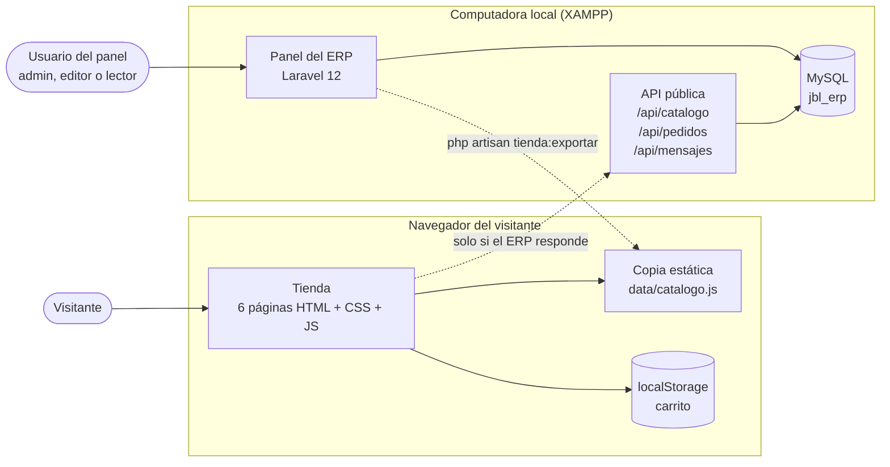
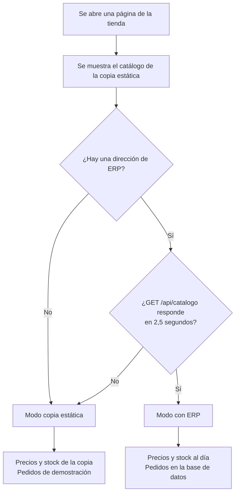

# Arquitectura

El proyecto tiene dos partes que viven en el mismo repositorio y que pueden funcionar por separado.

| Parte | Carpeta | Tecnología | Dónde corre |
|-------|---------|------------|-------------|
| Tienda | raíz (`*.html`, `css/`, `js/`, `assets/`, `data/`) | HTML5, CSS3 y JavaScript sin framework | Vercel (nube) o cualquier navegador |
| ERP | `erp/` | Laravel 12 sobre PHP 8.2, vistas Blade | Computadora local con XAMPP |
| Base de datos | `erp/database/` y `database/schema.sql` | MySQL / MariaDB | Computadora local con XAMPP |

La tienda es un proyecto académico no oficial: no cobra ni envía nada.

## Diagrama



## Los dos modos de la tienda

La tienda **no depende** del ERP. Cada página carga primero `data/catalogo.js`, una copia estática del catálogo, y después `js/tienda.js` intenta conectarse al ERP. Según el resultado, la tienda trabaja en uno de dos modos.



| | Modo con ERP | Modo copia estática |
|---|--------------|---------------------|
| Cuándo ocurre | El ERP está encendido y responde a tiempo | El ERP está apagado, no responde o no hay una dirección configurada (sitio publicado en Vercel) |
| Catálogo, precios y stock | Los de la base de datos, al día | Los de `data/catalogo.js`, tal como estaban cuando se generó |
| Carrito | En el navegador (`localStorage`) | En el navegador (`localStorage`) |
| Pedido | Se envía a `POST /api/pedidos`: queda en la base, descuenta stock y recibe un código `JBL-000001` | De demostración: se guarda solo en el navegador con un código `DEMO-xxxxxx` y no aparece en el panel |
| Seguimiento del pedido | Consulta `GET /api/pedidos/{codigo}?correo=` | No disponible: la página lo avisa |
| Formulario de contacto | Envía a `POST /api/mensajes`; el mensaje llega al panel | No disponible: el formulario lo avisa |

En el sitio publicado (sin dirección de ERP), el seguimiento y el formulario avisan que esa versión no está conectada al sistema. En una computadora local con el ERP apagado, avisan que el servidor no responde.

La dirección del ERP se decide así:

| Dónde se abre la tienda | Dirección del ERP que usa |
|-------------------------|---------------------------|
| En `localhost`, `127.0.0.1` o como archivo | `http://127.0.0.1:8000` |
| En cualquier otro dominio (Vercel) | Ninguna, salvo que `<html>` tenga el atributo `data-erp="https://..."` |

Por eso el sitio publicado en Vercel funciona en modo copia estática: el ERP no está alojado en la nube.

### La copia estática

`data/catalogo.js` **no se edita a mano**. Se genera desde el ERP:

```bash
cd erp
php artisan tienda:exportar
```

El comando escribe en ese archivo las reglas de la tienda, las categorías y los productos publicados, con el mismo formato que devuelve `GET /api/catalogo`. Hay que ejecutarlo después de cambiar productos o precios y antes de publicar, para que el sitio de Vercel muestre el catálogo actual.

## Archivos de la tienda

| Archivo | Para qué |
|---------|----------|
| `index.html` + `js/inicio.js` | Inicio: portada, categorías, destacados y ofertas |
| `catalogo.html` + `js/catalogo.js` | Catálogo con búsqueda, filtros y orden |
| `producto.html` + `js/producto.js` | Ficha de un producto |
| `carrito.html` + `js/carrito.js` | Carrito |
| `checkout.html` + `js/checkout.js` | Finalizar compra |
| `pedido.html` + `js/pedido.js` | Confirmación y seguimiento del pedido |
| `js/contacto.js` | Formulario de contacto del inicio |
| `js/tienda.js` | Base que comparten todas las páginas: de dónde sale el catálogo, carrito, cabecera, pie y avisos |
| `css/estilos.css` | Estilos de toda la tienda |

## API pública

Todas las rutas empiezan con `/api` y responden JSON. Cada una tiene su archivo en `erp/routes/api/`.

| Método y ruta | Qué hace | Respuestas | Límite |
|---------------|----------|------------|--------|
| `GET /api/catalogo` | Devuelve las reglas de la tienda, las categorías y los productos publicados | `200` | Sin límite propio |
| `POST /api/pedidos` | Registra el pedido del carrito | `201` con el código · `422` datos inválidos o sin stock | 10 por minuto |
| `GET /api/pedidos/{codigo}?correo=` | Devuelve el estado de un pedido si el correo coincide | `200` · `404` | 30 por minuto |
| `POST /api/mensajes` | Guarda un mensaje del formulario de contacto | `201` · `422` datos inválidos | 5 por minuto |

Al pasar el límite, la API responde `429`.

Dos cuidados de seguridad:

- Al registrar un pedido, el navegador solo envía qué productos y cuántos. Los precios, el envío y el total los calcula el ERP con los datos de la base, dentro de una transacción que bloquea las filas para que dos compras a la vez no vendan la misma unidad.
- El formulario de contacto tiene un campo trampa invisible. Si llega lleno, lo llenó un bot y el mensaje no se guarda.

## El panel del ERP

| Módulo | Qué hace | Quién entra |
|--------|----------|-------------|
| Inicio | Indicadores y gráficos | Todos |
| Pedidos | Atender los pedidos y cambiar su estado | Todos |
| Mensajes | Bandeja del formulario de contacto | Todos |
| Productos | Catálogo de la tienda | Todos |
| Categorías | Grupos de productos | Todos |
| Existencias | Stock y ajustes de inventario | Todos |
| Movimientos | Historial de cambios de stock | Todos |
| Usuarios | Cuentas y roles | Solo administrador |
| Bitácora | Quién hizo qué y cuándo | Solo administrador |
| Mi perfil | Datos y contraseña propios | Todos |

Los permisos los aplica un solo middleware, `erp/app/Http/Middleware/VerificarRol.php`:

| Rol | Ver | Modificar |
|-----|-----|-----------|
| Administrador (`admin`) | Todo | Todo |
| Editor (`editor`) | Todo, menos Usuarios y Bitácora | Todo lo que ve |
| Solo lectura (`lector`) | Todo, menos Usuarios y Bitácora | Nada, salvo su propio perfil |

## Estructura del repositorio

```
jbl-web/
├── index.html, catalogo.html, producto.html,
│   carrito.html, checkout.html, pedido.html     Páginas de la tienda
├── css/estilos.css            Estilos de la tienda
├── js/                        tienda.js (base) y un archivo por página
├── data/catalogo.js           Copia estática del catálogo (generada)
├── assets/img/                Fotografías y logotipo
├── erp/                       ERP en Laravel 12
│   ├── app/                   Controladores, modelos, middleware y comando tienda:exportar
│   ├── config/tienda.php      Reglas de la tienda (envío, pagos, estados y roles)
│   ├── database/              Migraciones y datos de ejemplo
│   ├── resources/views/erp/   Vistas del panel
│   ├── routes/                web.php, api.php y un archivo por módulo
│   └── tests/                 Pruebas automáticas
├── database/schema.sql        Base de datos completa en SQL
├── scripts/verificar-landing.mjs   Comprobaciones de la tienda
├── jenkins/                   Dockerfile y docker-compose.yml de Jenkins
├── Jenkinsfile                Pipeline de CI/CD
├── .github/                   Plantillas de issues y workflow de CI
├── vercel.json, .vercelignore Configuración del despliegue
└── docs/                      Documentación y páginas de la wiki
```

## Decisiones de arquitectura

| Decisión | Motivo |
|----------|--------|
| Tienda estática, sin framework | Abre con doble clic, carga rápido y se aloja gratis en cualquier servicio de archivos estáticos |
| Copia estática del catálogo, que el ERP reemplaza si responde | La tienda nunca se ve vacía, aunque el ERP falle o no esté en la nube |
| La copia se genera con un comando y usa el mismo formato que la API | La tienda tiene un solo código para los dos modos, y la copia no se desordena por ediciones a mano |
| Las reglas de la tienda están en un solo archivo (`config/tienda.php`) y viajan por la API | El panel y la tienda calculan el envío y los totales con los mismos números |
| El carrito guarda solo el id y la cantidad | El nombre y el precio se leen siempre del catálogo: un cambio de precio se refleja al instante |
| El stock solo cambia con un movimiento de inventario | Cada entrada, salida, venta o devolución deja rastro |
| Un archivo de rutas por módulo (`routes/erp/*.php`, `routes/api/*.php`) | Cada integrante agrega el suyo sin tocar los archivos de los demás, y los pull requests no chocan |
| Pruebas sobre SQLite en memoria | El pipeline no necesita un servidor MySQL para comprobar el ERP |
| Solo la tienda va a Vercel | Vercel aloja archivos estáticos; Laravel con MySQL necesita un servidor PHP con base de datos |
