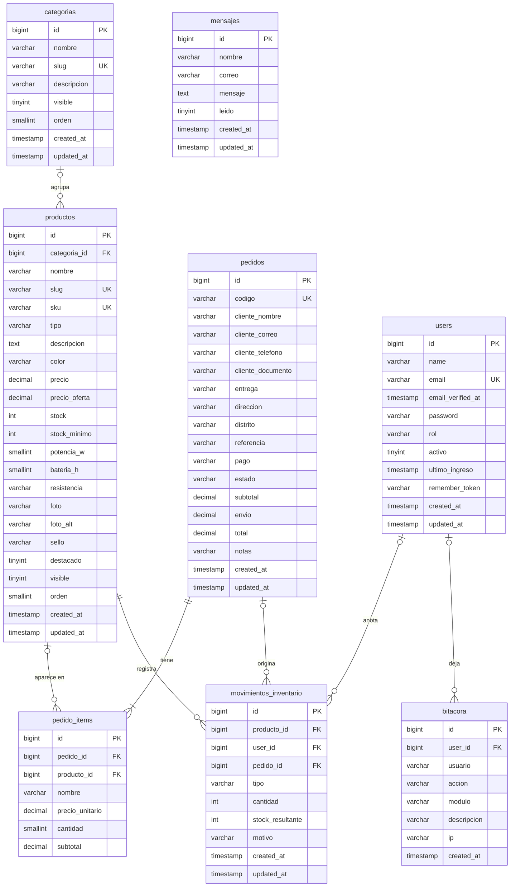

# Base de datos

El ERP usa una base **MySQL / MariaDB** llamada `jbl_erp`. Se crea con las migraciones de Laravel (`php artisan migrate --seed`) o con el script [`database/schema.sql`](https://github.com/Dietri-Diaz/jbl-web/blob/main/database/schema.sql).

## Modelo entidad-relación

La base tiene 16 tablas: 8 del negocio y 8 que administra Laravel. Entre las tablas del negocio hay 7 claves foráneas.

**Tablas del negocio**

- **users**: las personas que entran al panel. Cada una tiene un rol (`admin`, `editor` o `lector`) y puede estar activa o desactivada.
- **categorias**: los grupos en que se ordena el catálogo (parlantes portátiles, audífonos, etc.).
- **productos**: lo que vende la tienda. Cada fila tiene su precio, su precio de oferta, su stock, su ficha técnica, su foto y si está publicada.
- **pedidos**: cada compra hecha en la tienda, con los datos del cliente, la entrega, el pago, el estado y los totales.
- **pedido_items**: el detalle de cada pedido: qué producto, a qué precio y cuántas unidades.
- **movimientos_inventario**: el historial del stock. Cada entrada, salida, ajuste, venta o devolución es una fila.
- **mensajes**: lo que los visitantes envían desde el formulario de contacto.
- **bitacora**: el registro de lo que hace cada usuario en el panel.

**Relaciones**

| Relación | Tipo | Clave foránea | Si se elimina el padre |
|----------|------|---------------|------------------------|
| Una categoría agrupa muchos productos | 1 a muchos | `productos.categoria_id` → `categorias.id` | El producto queda sin categoría (`SET NULL`) |
| Un pedido tiene muchas líneas | 1 a muchos | `pedido_items.pedido_id` → `pedidos.id` | Se eliminan sus líneas (`CASCADE`) |
| Un producto aparece en muchas líneas de pedido | 1 a muchos | `pedido_items.producto_id` → `productos.id` | La línea se conserva sin producto (`SET NULL`) |
| Un producto tiene muchos movimientos de inventario | 1 a muchos | `movimientos_inventario.producto_id` → `productos.id` | Se eliminan sus movimientos (`CASCADE`) |
| Un usuario registra muchos movimientos | 1 a muchos | `movimientos_inventario.user_id` → `users.id` | El movimiento se conserva sin usuario (`SET NULL`) |
| Un pedido origina muchos movimientos (ventas y devoluciones) | 1 a muchos | `movimientos_inventario.pedido_id` → `pedidos.id` | El movimiento se conserva sin pedido (`SET NULL`) |
| Un usuario tiene muchos registros en la bitácora | 1 a muchos | `bitacora.user_id` → `users.id` | El registro se conserva sin usuario (`SET NULL`) |

Tres decisiones del modelo que conviene conocer:

- **La línea del pedido guarda una copia del nombre y del precio** (`pedido_items.nombre` y `precio_unitario`). Así el pedido no cambia si después se edita o se elimina el producto. Por la misma razón, `bitacora.usuario` guarda el nombre de quien hizo la acción.
- **El stock actual está en `productos.stock`, y su historia en `movimientos_inventario`.** Cada movimiento guarda cuánto cambió (`cantidad`, positiva si entra y negativa si sale) y cuánto quedó (`stock_resultante`).
- **`mensajes` no se relaciona con ninguna tabla**: los escriben visitantes que no tienen cuenta. `pedidos` tampoco se relaciona con `users`, porque los clientes de la tienda no se registran: sus datos van en el propio pedido.



Las 8 tablas de Laravel (`migrations`, `password_reset_tokens`, `sessions`, `cache`, `cache_locks`, `jobs`, `job_batches` y `failed_jobs`) no aparecen en el diagrama porque no guardan datos del negocio. Ninguna tiene claves foráneas: `sessions.user_id` apunta a un usuario, pero solo lleva un índice.

## Diccionario de datos

Todas las tablas usan el motor InnoDB y el juego de caracteres `utf8mb4`.

### users

| Campo | Tipo | Restricción | Descripción |
|-------|------|-------------|-------------|
| id | BIGINT UNSIGNED | PK, autoincremental | Identificador del usuario |
| name | VARCHAR(255) | NOT NULL | Nombre que se muestra en el panel |
| email | VARCHAR(255) | NOT NULL, UNIQUE | Correo con el que inicia sesión |
| email_verified_at | TIMESTAMP | NULL | Fecha en que se verificó el correo (no se usa) |
| password | VARCHAR(255) | NOT NULL | Contraseña cifrada con bcrypt |
| rol | VARCHAR(20) | NOT NULL, DEFAULT 'admin' | Rol en el panel: `admin`, `editor` o `lector` |
| activo | TINYINT(1) | NOT NULL, DEFAULT 1 | 1 si puede ingresar, 0 si la cuenta está desactivada |
| ultimo_ingreso | TIMESTAMP | NULL | Fecha de su último inicio de sesión |
| remember_token | VARCHAR(100) | NULL | Token de la opción «recordarme» |
| created_at | TIMESTAMP | NULL | Fecha de creación |
| updated_at | TIMESTAMP | NULL | Fecha de la última modificación |

### categorias

| Campo | Tipo | Restricción | Descripción |
|-------|------|-------------|-------------|
| id | BIGINT UNSIGNED | PK, autoincremental | Identificador de la categoría |
| nombre | VARCHAR(60) | NOT NULL | Nombre, por ejemplo «Parlantes portátiles» |
| slug | VARCHAR(70) | NOT NULL, UNIQUE | Nombre para direcciones, por ejemplo `parlantes-portatiles` |
| descripcion | VARCHAR(200) | NULL | Texto breve que acompaña a la categoría en la tienda |
| visible | TINYINT(1) | NOT NULL, DEFAULT 1 | 1 si se muestra en la tienda, 0 si está oculta |
| orden | SMALLINT UNSIGNED | NOT NULL, DEFAULT 0 | Posición en la tienda, de menor a mayor |
| created_at | TIMESTAMP | NULL | Fecha de creación |
| updated_at | TIMESTAMP | NULL | Fecha de la última modificación |

### productos

| Campo | Tipo | Restricción | Descripción |
|-------|------|-------------|-------------|
| id | BIGINT UNSIGNED | PK, autoincremental | Identificador del producto |
| categoria_id | BIGINT UNSIGNED | NULL, FK a `categorias.id` (ON DELETE SET NULL) | Categoría a la que pertenece |
| nombre | VARCHAR(80) | NOT NULL | Nombre comercial, por ejemplo «JBL Go 4» |
| slug | VARCHAR(90) | NOT NULL, UNIQUE | Nombre para direcciones y archivos, por ejemplo `go-4` |
| sku | VARCHAR(30) | NULL, UNIQUE | Código interno del producto, por ejemplo `JBL-GO4-MO` |
| tipo | VARCHAR(40) | NOT NULL | Tipo de producto, por ejemplo «Ultra compacto» |
| descripcion | TEXT | NULL | Texto de la ficha del producto |
| color | VARCHAR(30) | NULL | Color del modelo |
| precio | DECIMAL(8,2) | NOT NULL, DEFAULT 0.00 | Precio normal en soles |
| precio_oferta | DECIMAL(8,2) | NULL | Precio de oferta; NULL si no está en oferta |
| stock | INT UNSIGNED | NOT NULL, DEFAULT 0 | Unidades disponibles |
| stock_minimo | INT UNSIGNED | NOT NULL, DEFAULT 5 | Desde cuántas unidades el panel avisa «stock bajo» |
| potencia_w | SMALLINT UNSIGNED | NULL | Potencia en vatios |
| bateria_h | SMALLINT UNSIGNED | NULL | Duración de la batería en horas |
| resistencia | VARCHAR(10) | NULL | Grado de protección, por ejemplo IPX7 o IP67 |
| foto | VARCHAR(255) | NULL | Ruta de la foto dentro de `public/` |
| foto_alt | VARCHAR(160) | NULL | Texto alternativo de la foto (accesibilidad) |
| sello | VARCHAR(30) | NULL | Texto que destaca la tarjeta del producto |
| destacado | TINYINT(1) | NOT NULL, DEFAULT 0 | 1 si aparece en los destacados del inicio |
| visible | TINYINT(1) | NOT NULL, DEFAULT 1 | 1 si se publica en la tienda, 0 si está oculto |
| orden | SMALLINT UNSIGNED | NOT NULL, DEFAULT 0 | Posición en la tienda, de menor a mayor |
| created_at | TIMESTAMP | NULL | Fecha de creación |
| updated_at | TIMESTAMP | NULL | Fecha de la última modificación |

El índice único de `slug` se llama `parlantes_slug_unique`: la tabla nació como `parlantes` y una migración la renombró a `productos`.

### pedidos

| Campo | Tipo | Restricción | Descripción |
|-------|------|-------------|-------------|
| id | BIGINT UNSIGNED | PK, autoincremental | Identificador del pedido |
| codigo | VARCHAR(20) | NOT NULL, UNIQUE | Código que recibe el cliente, por ejemplo `JBL-000007` |
| cliente_nombre | VARCHAR(80) | NOT NULL | Nombre del cliente |
| cliente_correo | VARCHAR(120) | NOT NULL, índice | Correo del cliente; se pide para el seguimiento |
| cliente_telefono | VARCHAR(20) | NOT NULL | Celular del cliente |
| cliente_documento | VARCHAR(15) | NULL | DNI o RUC (opcional) |
| entrega | VARCHAR(20) | NOT NULL | Forma de entrega: `delivery` (a domicilio) o `recojo` (en tienda) |
| direccion | VARCHAR(160) | NULL | Dirección de entrega; NULL si es recojo en tienda |
| distrito | VARCHAR(60) | NULL | Distrito de entrega; NULL si es recojo en tienda |
| referencia | VARCHAR(160) | NULL | Referencia para ubicar la dirección |
| pago | VARCHAR(20) | NOT NULL | Forma de pago: `contraentrega`, `yape` o `transferencia` |
| estado | VARCHAR(20) | NOT NULL, DEFAULT 'pendiente', índice | `pendiente`, `confirmado`, `enviado`, `entregado` o `cancelado` |
| subtotal | DECIMAL(10,2) | NOT NULL | Suma de las líneas del pedido |
| envio | DECIMAL(8,2) | NOT NULL, DEFAULT 0.00 | Costo del envío |
| total | DECIMAL(10,2) | NOT NULL | Subtotal más envío |
| notas | VARCHAR(300) | NULL | Indicaciones del cliente |
| created_at | TIMESTAMP | NULL | Fecha en que se hizo el pedido |
| updated_at | TIMESTAMP | NULL | Fecha de la última modificación |

### pedido_items

| Campo | Tipo | Restricción | Descripción |
|-------|------|-------------|-------------|
| id | BIGINT UNSIGNED | PK, autoincremental | Identificador de la línea |
| pedido_id | BIGINT UNSIGNED | NOT NULL, FK a `pedidos.id` (ON DELETE CASCADE) | Pedido al que pertenece |
| producto_id | BIGINT UNSIGNED | NULL, FK a `productos.id` (ON DELETE SET NULL) | Producto comprado; NULL si el producto se eliminó |
| nombre | VARCHAR(80) | NOT NULL | Nombre del producto al momento de la compra |
| precio_unitario | DECIMAL(8,2) | NOT NULL | Precio de cada unidad al momento de la compra |
| cantidad | SMALLINT UNSIGNED | NOT NULL | Unidades compradas |
| subtotal | DECIMAL(10,2) | NOT NULL | Precio unitario por cantidad |

### movimientos_inventario

| Campo | Tipo | Restricción | Descripción |
|-------|------|-------------|-------------|
| id | BIGINT UNSIGNED | PK, autoincremental | Identificador del movimiento |
| producto_id | BIGINT UNSIGNED | NOT NULL, FK a `productos.id` (ON DELETE CASCADE) | Producto cuyo stock cambió |
| user_id | BIGINT UNSIGNED | NULL, FK a `users.id` (ON DELETE SET NULL) | Usuario que lo registró; NULL si lo generó la tienda |
| pedido_id | BIGINT UNSIGNED | NULL, FK a `pedidos.id` (ON DELETE SET NULL) | Pedido que lo originó, en ventas y devoluciones |
| tipo | VARCHAR(20) | NOT NULL, índice | `entrada`, `salida`, `ajuste`, `venta` o `devolucion` |
| cantidad | INT | NOT NULL | Unidades que cambiaron: positiva si entran, negativa si salen |
| stock_resultante | INT UNSIGNED | NOT NULL | Stock del producto después del movimiento |
| motivo | VARCHAR(160) | NULL | Explicación, por ejemplo «Stock inicial» o «Pedido JBL-000007» |
| created_at | TIMESTAMP | NULL | Fecha del movimiento |
| updated_at | TIMESTAMP | NULL | Fecha de la última modificación |

### mensajes

| Campo | Tipo | Restricción | Descripción |
|-------|------|-------------|-------------|
| id | BIGINT UNSIGNED | PK, autoincremental | Identificador del mensaje |
| nombre | VARCHAR(80) | NOT NULL | Nombre de quien escribe |
| correo | VARCHAR(120) | NOT NULL | Correo para responderle |
| mensaje | TEXT | NOT NULL | Texto del mensaje (la API exige entre 10 y 1000 caracteres) |
| leido | TINYINT(1) | NOT NULL, DEFAULT 0 | 1 si ya se leyó en el panel |
| created_at | TIMESTAMP | NULL | Fecha en que llegó |
| updated_at | TIMESTAMP | NULL | Fecha de la última modificación |

### bitacora

| Campo | Tipo | Restricción | Descripción |
|-------|------|-------------|-------------|
| id | BIGINT UNSIGNED | PK, autoincremental | Identificador del registro |
| user_id | BIGINT UNSIGNED | NULL, FK a `users.id` (ON DELETE SET NULL) | Usuario que hizo la acción |
| usuario | VARCHAR(80) | NOT NULL | Nombre del usuario al momento de la acción |
| accion | VARCHAR(20) | NOT NULL, índice | `ingresar`, `salir`, `crear`, `editar`, `eliminar`, `estado` o `stock` |
| modulo | VARCHAR(30) | NOT NULL, índice | Módulo del panel, por ejemplo `pedidos` o `productos` |
| descripcion | VARCHAR(255) | NOT NULL | Qué se hizo, por ejemplo «Pasó el pedido JBL-000001 a Entregado» |
| ip | VARCHAR(45) | NULL | Dirección IP desde la que se hizo |
| created_at | TIMESTAMP | NULL, índice | Fecha de la acción |

Esta tabla no tiene `updated_at`: un registro de la bitácora no se modifica.

### Tablas de Laravel

| Tabla | Campo | Tipo | Restricción | Descripción |
|-------|-------|------|-------------|-------------|
| migrations | id | INT UNSIGNED | PK, autoincremental | Identificador del registro |
| migrations | migration | VARCHAR(255) | NOT NULL | Nombre del archivo de migración ya ejecutado |
| migrations | batch | INT | NOT NULL | Tanda en la que se ejecutó |
| password_reset_tokens | email | VARCHAR(255) | PK | Correo del usuario que pidió restablecer su contraseña |
| password_reset_tokens | token | VARCHAR(255) | NOT NULL | Token cifrado del enlace |
| password_reset_tokens | created_at | TIMESTAMP | NULL | Fecha de la solicitud |
| sessions | id | VARCHAR(255) | PK | Identificador de la sesión (va en la cookie) |
| sessions | user_id | BIGINT UNSIGNED | NULL, índice | Usuario dueño de la sesión; NULL si no ha ingresado |
| sessions | ip_address | VARCHAR(45) | NULL | Dirección IP del navegador |
| sessions | user_agent | TEXT | NULL | Navegador y sistema operativo |
| sessions | payload | LONGTEXT | NOT NULL | Datos de la sesión, serializados |
| sessions | last_activity | INT | NOT NULL, índice | Momento de la última actividad (tiempo Unix) |
| cache | key | VARCHAR(255) | PK | Nombre del dato guardado en caché |
| cache | value | MEDIUMTEXT | NOT NULL | Valor guardado |
| cache | expiration | INT | NOT NULL, índice | Momento en que vence (tiempo Unix) |
| cache_locks | key | VARCHAR(255) | PK | Nombre del bloqueo |
| cache_locks | owner | VARCHAR(255) | NOT NULL | Proceso que tiene el bloqueo |
| cache_locks | expiration | INT | NOT NULL, índice | Momento en que vence |
| jobs | id | BIGINT UNSIGNED | PK, autoincremental | Identificador de la tarea |
| jobs | queue | VARCHAR(255) | NOT NULL, índice | Cola a la que pertenece |
| jobs | payload | LONGTEXT | NOT NULL | Contenido de la tarea |
| jobs | attempts | TINYINT UNSIGNED | NOT NULL | Intentos realizados |
| jobs | reserved_at | INT UNSIGNED | NULL | Momento en que un proceso la tomó |
| jobs | available_at | INT UNSIGNED | NOT NULL | Momento desde el que se puede ejecutar |
| jobs | created_at | INT UNSIGNED | NOT NULL | Momento de creación |
| job_batches | id | VARCHAR(255) | PK | Identificador del lote |
| job_batches | name | VARCHAR(255) | NOT NULL | Nombre del lote |
| job_batches | total_jobs | INT | NOT NULL | Tareas del lote |
| job_batches | pending_jobs | INT | NOT NULL | Tareas pendientes |
| job_batches | failed_jobs | INT | NOT NULL | Tareas fallidas |
| job_batches | failed_job_ids | LONGTEXT | NOT NULL | Identificadores de las tareas fallidas |
| job_batches | options | MEDIUMTEXT | NULL | Opciones del lote |
| job_batches | cancelled_at | INT | NULL | Momento de cancelación |
| job_batches | created_at | INT | NOT NULL | Momento de creación |
| job_batches | finished_at | INT | NULL | Momento de finalización |
| failed_jobs | id | BIGINT UNSIGNED | PK, autoincremental | Identificador del registro |
| failed_jobs | uuid | VARCHAR(255) | NOT NULL, UNIQUE | Identificador único de la tarea fallida |
| failed_jobs | connection | TEXT | NOT NULL | Conexión de la cola |
| failed_jobs | queue | TEXT | NOT NULL | Cola en la que falló |
| failed_jobs | payload | LONGTEXT | NOT NULL | Contenido de la tarea |
| failed_jobs | exception | LONGTEXT | NOT NULL | Error que la hizo fallar |
| failed_jobs | failed_at | TIMESTAMP | NOT NULL, DEFAULT CURRENT_TIMESTAMP | Momento del fallo |

## Datos de ejemplo

Los cargan los seeders de Laravel (`php artisan migrate --seed`) y también vienen en `database/schema.sql`.

| Tabla | Registros | Contenido |
|-------|-----------|-----------|
| users | 3 | `admin@jbl.pe` (admin), `editor@jbl.pe` (editor) y `consulta@jbl.pe` (lector). Contraseña de los tres: `admin123` |
| categorias | 5 | Parlantes portátiles, Parlantes de fiesta, Audífonos, Audio para casa y Audio profesional |
| productos | 26 | Modelos reales de JBL con su foto |
| pedidos | 22 | Pedidos de las últimas dos semanas, en los cinco estados |
| pedido_items | 44 | El detalle de esos pedidos |
| movimientos_inventario | 71 | El stock inicial, las ventas de los pedidos y las devoluciones de los cancelados |
| mensajes | 5 | Consultas de ejemplo |
| bitacora | 26 | Actividad de ejemplo: ingresos, cambios de estado y ediciones |

Los modelos y las fotografías son reales (Wikimedia Commons; los créditos están en `docs/creditos-imagenes.md`). Los precios, el stock, los clientes y los pedidos son inventados para la demostración; los correos de los clientes usan el dominio `example.com`.

De las tablas de Laravel, solo `migrations` trae datos (las 10 migraciones ejecutadas). Las demás las llena el framework mientras la aplicación está en uso.

## El script schema.sql

[`database/schema.sql`](https://github.com/Dietri-Diaz/jbl-web/blob/main/database/schema.sql) equivale a ejecutar `php artisan migrate --seed`. Sirve para revisar el modelo o para cargar la base sin Laravel:

```bash
mysql -u root -p < database/schema.sql
```

- Crea la base `jbl_erp` si no existe. **Borra y vuelve a crear las tablas**, así que no hay que usarlo sobre una base con datos que se quieran conservar.
- Se genera con `mysqldump` a partir de una base recién migrada y sembrada, por eso coincide con las migraciones. No conviene editarlo a mano: si cambia una migración, se vuelve a generar.
- Se probó en MariaDB 10.4.32 (la de XAMPP).
