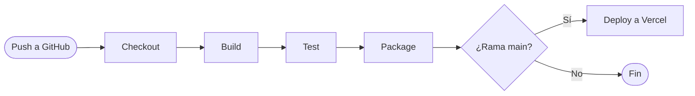

# CI/CD

El proyecto tiene dos automatizaciones que se complementan.

| Herramienta | Dónde corre | Qué hace | Cuándo |
|-------------|-------------|----------|--------|
| **Jenkins** | Contenedor Docker en una computadora del equipo | Pipeline completo: Checkout, Build, Test, Package y Deploy | En cada push (webhook de GitHub) |
| **GitHub Actions** | Nube de GitHub | Build y Test | En cada pull request y push a `main` o `develop` |

Jenkins es el pipeline principal y el único que despliega. GitHub Actions repite las comprobaciones para que cada pull request muestre su check verde o rojo aunque el Jenkins local esté apagado.

> **Estado al 16/11/2026.** El workflow de GitHub Actions corre en cada push y en cada pull request. Jenkins está configurado en Docker con el job `jbl-web`: la ejecución sobre `main` pasó las cinco etapas y desplegó la tienda en Vercel. El webhook de GitHub llega a Jenkins por un túnel de ngrok, así que cada push arranca una ejecución sola mientras el túnel esté abierto. Los pasos están en [`docs/tercer-avance.md`](https://github.com/Dietri-Diaz/jbl-web/blob/main/docs/tercer-avance.md).

## Etapas del pipeline de Jenkins

Están definidas en el [`Jenkinsfile`](https://github.com/Dietri-Diaz/jbl-web/blob/main/Jenkinsfile) de la raíz.



| Etapa | Qué hace | Falla si |
|-------|----------|----------|
| Checkout | Descarga el commit que disparó el pipeline | El repositorio no responde |
| Build | Instala las dependencias del ERP con Composer y prepara el `.env` | Una dependencia no se puede instalar |
| Test | Ejecuta `node scripts/verificar-landing.mjs` y `php artisan test` | Hay un enlace roto, un dato incompleto en el catálogo, una foto que falta, un error de sintaxis o una prueba en rojo |
| Package | Empaqueta la tienda (`*.html`, `css`, `js`, `assets`, `data` y la página de créditos) en `jbl-landing-<número>.tar.gz` y lo guarda como artefacto | Falta un archivo de la tienda |
| Deploy | Publica la tienda en Vercel con la CLI. Solo en `main` | El token no es válido o Vercel rechaza el despliegue |

Si una etapa falla, las siguientes no se ejecutan: un cambio con pruebas en rojo nunca llega a Vercel.

## Qué se comprueba

**Tienda** (`scripts/verificar-landing.mjs`, solo necesita Node.js):

1. Cada archivo local que enlazan las 6 páginas HTML existe.
2. `data/catalogo.js` carga y define la tienda, las categorías y los productos. Cada producto tiene sus datos completos, un slug que no se repite, una categoría que existe, un precio válido y, si está en oferta, una oferta menor que su precio.
3. La foto de cada producto existe en el repositorio.
4. Los archivos de `js/` no tienen errores de sintaxis.

Hoy revisa 6 páginas, 26 productos en 5 categorías y 8 archivos de JavaScript.

**ERP** (`php artisan test`, sobre SQLite en memoria): 46 pruebas con 333 aserciones. Casi todas están en tres archivos de `erp/tests/Feature/`.

| Grupo | Archivo | Pruebas | Qué garantiza |
|-------|---------|---------|---------------|
| Arranque | `ExampleTest.php` | 3 | La raíz redirige al panel, el panel exige iniciar sesión y el login carga |
| API: catálogo | `ApiLandingTest.php` | 2 | Solo se publican productos y categorías visibles, en el orden del panel y con su oferta |
| API: pedidos | `ApiLandingTest.php` | 7 | Un pedido válido se registra, cobra el envío correcto y descuenta stock; el precio sale de la base y no del navegador; se rechazan los pedidos sin stock, con productos ocultos o incompletos; el seguimiento exige el correo del pedido |
| API: mensajes | `ApiLandingTest.php` | 3 | Un mensaje válido se guarda, uno incompleto se rechaza y el campo trampa descarta a los bots |
| Panel: pantallas y exportaciones | `PanelTest.php` | 4 | Todas las pantallas responden (también vacías), el lector no ve botones para modificar y los CSV se descargan bien |
| Panel: roles | `PanelTest.php` | 3 | El lector no puede modificar nada, salvo su perfil; el editor no entra a Usuarios ni a Bitácora |
| Panel: productos y categorías | `PanelTest.php` | 6 | Crear un producto guarda su foto y su stock inicial, editar no cambia el stock, publicar y ocultar funciona, y no se elimina un producto con pedidos |
| Panel: inventario | `PanelTest.php` | 4 | Una entrada suma, una salida no deja el stock en negativo, un ajuste fija el stock exacto y todo movimiento exige motivo |
| Panel: pedidos | `PanelTest.php` | 4 | Un pedido avanza por sus estados, cancelar devuelve el stock y una transición inválida se rechaza |
| Panel: mensajes | `PanelTest.php` | 1 | Abrir un mensaje lo marca como leído y eliminarlo queda en la bitácora |
| Panel: usuarios, perfil y acceso | `PanelTest.php` | 8 | Se crean usuarios con rol, siempre queda un administrador activo, cambiar la contraseña exige la actual, una cuenta inactiva no ingresa, y los ingresos y salidas quedan en la bitácora |
| Prueba de ejemplo de Laravel | `tests/Unit/ExampleTest.php` | 1 | El entorno de pruebas funciona |

Las pruebas necesitan la extensión **GD** de PHP, porque generan una imagen de prueba para la foto de los productos. La imagen de Jenkins y el workflow de GitHub Actions ya la incluyen.

## Levantar Jenkins

Requisito: Docker Desktop instalado y encendido.

```bash
docker compose -f jenkins/docker-compose.yml up -d --build
docker exec jbl-jenkins cat /var/jenkins_home/secrets/initialAdminPassword
```

Jenkins queda en http://localhost:8080. La imagen ya incluye PHP con sus extensiones (entre ellas GD), Composer, Node.js 22, la CLI de Vercel y los plugins del pipeline.

Para apagarlo sin perder la configuración:

```bash
docker compose -f jenkins/docker-compose.yml down
```

## Credenciales en Jenkins

Se registran en **Manage Jenkins → Credentials → System → Global credentials → Add Credentials**.

| ID | Tipo | Contenido |
|----|------|-----------|
| `github-jbl` | Username with password | Usuario de GitHub y un token personal con permiso `repo` |
| `vercel-token` | Secret text | Token de la cuenta de Vercel |
| `vercel-org-id` | Secret text | `orgId` del archivo `.vercel/project.json` |
| `vercel-project-id` | Secret text | `projectId` del archivo `.vercel/project.json` |

Ningún secreto está escrito en el repositorio. El `Jenkinsfile` solo menciona los ID, y Jenkins reemplaza los valores por `****` si aparecen en la consola.

## Webhook

GitHub avisa a Jenkins de cada push en la dirección `https://<dominio-de-ngrok>/github-webhook/`. Como Jenkins corre en una computadora local, se expone con ngrok:

```bash
ngrok http 8080
```

La dirección gratuita de ngrok cambia cada vez que se reinicia, así que hay que actualizarla en **Settings → Webhooks** del repositorio.

## Workflow de GitHub Actions

Está en [`.github/workflows/ci.yml`](https://github.com/Dietri-Diaz/jbl-web/blob/main/.github/workflows/ci.yml) y tiene dos trabajos que corren en paralelo:

| Trabajo | Pasos |
|---------|-------|
| Landing | Descargar el código, preparar Node.js 22, ejecutar `verificar-landing.mjs` (verifica la tienda) |
| ERP | Descargar el código, preparar PHP 8.2 con GD, `composer install`, preparar el `.env`, `php artisan test` |

## Beneficios

- Los errores aparecen minutos después del push, no el día de la exposición.
- Nadie depende de «en mi computadora funciona»: las comprobaciones corren siempre igual, en un entorno limpio.
- El despliegue deja de ser una tarea manual que una sola persona sabe hacer.
- Cada versión publicada pasó por las mismas pruebas, y queda registro de quién cambió qué y cuándo.
