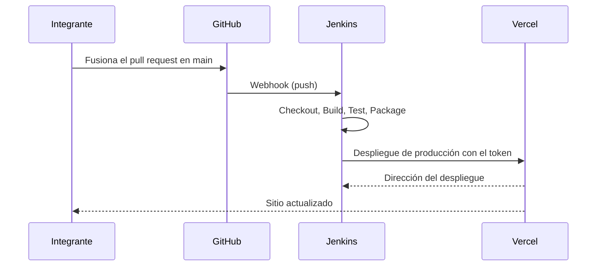

# Despliegue

La tienda se publica en **Vercel**: https://jbl-web-ebon.vercel.app

> **Estado al 16/11/2026.** El proyecto `jbl-web` existe en Vercel y la versión 2.0.0 está publicada. El despliegue de producción lo hizo Jenkins (ejecución n.º 2 del job `jbl-web`, sobre `main`), con el token guardado en Jenkins Credentials.

## Qué se publica

Solo la tienda: las 6 páginas (`index.html`, `catalogo.html`, `producto.html`, `carrito.html`, `checkout.html` y `pedido.html`), `css/`, `js/`, `assets/`, `data/` y `docs/creditos-imagenes.md`. El archivo `.vercelignore` deja fuera el ERP, la base de datos, los scripts, Jenkins y el resto de la documentación.

El ERP no va a Vercel porque Vercel aloja archivos estáticos y funciones, y Laravel con MySQL necesita un servidor PHP con base de datos. Por eso el sitio publicado trabaja con la **copia estática** del catálogo (`data/catalogo.js`):

| En el sitio publicado | Qué pasa |
|-----------------------|----------|
| Catálogo, precios y stock | Son los de la copia, tal como estaban cuando se generó |
| Carrito | Funciona igual: se guarda en el navegador |
| Finalizar compra | Crea un pedido de demostración con un código `DEMO-xxxxxx`, guardado solo en el navegador. No llega al panel |
| Seguimiento del pedido | Avisa que no está disponible en esa versión del sitio |
| Formulario de contacto | Avisa que todavía no está conectado |

En todos los casos es una tienda de demostración de un proyecto académico no oficial: no se cobra ni se envía nada.

## Antes de publicar: actualizar la copia del catálogo

Si se cambiaron productos o precios en el ERP, hay que volver a generar la copia y subirla al repositorio, porque es lo único que verá el sitio publicado:

```bash
cd erp
php artisan tienda:exportar
cd ..
node scripts/verificar-landing.mjs
```

El comando escribe `data/catalogo.js` (no se edita a mano) y copia a `assets/img/productos/` las fotos subidas desde el panel. Después se hace el commit de esos archivos por el flujo normal.

## Quién despliega qué

| Evento | Quién despliega | Resultado |
|--------|-----------------|-----------|
| Pull request o push a una rama que no es `main` | Vercel, automáticamente | Un **preview** con dirección propia, enlazado en el pull request |
| Fusión en `main` | Jenkins, después de pasar Build, Test y Package | **Producción** |

Esto se logra con una línea de `vercel.json` que desactiva el despliegue automático de Vercel para `main`:

```json
{
  "git": {
    "deploymentEnabled": {
      "main": false
    }
  }
}
```

Así producción solo cambia si el pipeline terminó en verde.

## Proceso de despliegue a producción



1. Se fusiona el pull request de `develop` en `main`.
2. GitHub avisa a Jenkins por el webhook.
3. Jenkins ejecuta Checkout, Build, Test y Package.
4. Si todo pasa, la etapa Deploy ejecuta `vercel deploy --prod --yes --token "$VERCEL_TOKEN"`.
5. Vercel responde con la dirección del despliegue, que Jenkins guarda en `url-despliegue.txt`.

## Volver a una versión anterior

En Vercel: **Project → Deployments**, elegir el despliegue anterior que funcionaba, menú de tres puntos, **Promote to Production**. El cambio es inmediato y no necesita tocar el repositorio.

Después se corrige el problema en una rama `bugfix/`, siguiendo el flujo normal.

## Variables de entorno

La tienda es estática y no usa variables de entorno. Si más adelante el ERP se aloja en un servidor propio, se le indica a la tienda con el atributo `data-erp` en la etiqueta `<html>` de cada una de las 6 páginas:

```html
<html lang="es" data-erp="https://erp.ejemplo.com">
```

Con ese atributo, el sitio publicado pasaría a usar los datos del ERP y a registrar los pedidos en la base de datos.

Los secretos del despliegue (token de Vercel e identificadores del proyecto) están en Jenkins Credentials, nunca en el repositorio.

## Dominio

Vercel asigna una dirección `*.vercel.app` gratuita con HTTPS. En **Project → Settings → Domains** se puede cambiar el nombre o agregar un dominio propio.
