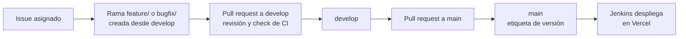

# Flujo de trabajo

## Ramas

| Rama | Para qué | Quién escribe en ella |
|------|----------|-----------------------|
| `main` | Lo que está publicado. Cada fusión se etiqueta con una versión y dispara el despliegue | Nadie directamente: solo recibe pull requests desde `develop` |
| `develop` | Integración del trabajo del equipo | Nadie directamente: solo recibe pull requests |
| `feature/<nombre>` | Una función nueva | El integrante responsable |
| `bugfix/<nombre>` | La corrección de un error | El integrante responsable |

Los nombres van en minúsculas, sin tildes y con guiones: `feature/galeria-productos`, `bugfix/fichas-tecnicas`.



## Paso a paso

1. **Tomar un issue.** Todo cambio empieza en un issue asignado. En el tablero, la tarjeta pasa a «En progreso».
2. **Crear la rama desde `develop` actualizado.**

   ```bash
   git switch develop
   git pull
   git switch -c feature/erp-tienda
   ```

3. **Trabajar con commits pequeños**, cada uno con un solo cambio.
4. **Comprobar antes de subir.**

   ```bash
   node scripts/verificar-landing.mjs
   cd erp && php artisan test
   ```

5. **Subir la rama y abrir el pull request hacia `develop`.** La tarjeta pasa a «En revisión».

   ```bash
   git push -u origin feature/erp-tienda
   ```

6. **Revisión.** Otro integrante lee el cambio y lo aprueba o pide ajustes. El check de GitHub Actions debe estar en verde.
7. **Fusión.** El líder fusiona el pull request con un merge commit (no squash), para que la rama quede en el historial.
8. **Publicación.** Cuando `develop` está estable, se abre un pull request de `develop` a `main`. Al fusionarlo, Jenkins despliega la tienda y se cierran los issues enlazados. La tarjeta pasa a «Hecho».
9. **Versión.** Se etiqueta `main`:

   ```bash
   git switch main
   git pull
   git tag -a v2.0.0 -m "Tienda completa, ERP ampliado, seguimiento de incidentes, CI/CD y despliegue en Vercel"
   git push origin v2.0.0
   ```

## Convención de commits

Formato: `tipo: descripción en presente y en minúsculas`, en español, sin punto final y en menos de 72 caracteres.

| Tipo | Cuándo se usa | Ejemplo |
|------|---------------|---------|
| `feat` | Función nueva | `feat: agrega el formulario de contacto a la landing` |
| `fix` | Corrección de un error | `fix: corrige la potencia del Flip 3 en la galería` |
| `docs` | Solo documentación | `docs: documenta la instalación y el uso del ERP` |
| `style` | Formato o estilos, sin cambiar el comportamiento | `style: alinea las tarjetas a la misma proporción` |
| `refactor` | Reordenar código sin cambiar lo que hace | `refactor: separa las rutas del ERP por módulo` |
| `test` | Agregar o corregir pruebas | `test: agrega las pruebas de la API de la landing` |
| `ci` | Pipeline, Jenkins, GitHub Actions o despliegue | `ci: agrega el Jenkinsfile con las etapas de integración` |
| `chore` | Mantenimiento que no toca el código | `chore: ignora la carpeta .vercel` |

Si el commit resuelve un issue, se indica en una línea aparte al final del mensaje:

```
feat: amplía el ERP con categorías, inventario, pedidos, roles y bitácora

Incluye las pruebas del panel y de la API.

Closes #26
Closes #32
```

## Issues y commits

- `Closes #26`, `Fixes #26` o `Resolves #26` cierran el issue **cuando el commit llega a `main`**, que es la rama por defecto. En este flujo eso ocurre al fusionar `develop` en `main`, no al fusionar la rama en `develop`.
- `Refs #26` enlaza el commit con el issue sin cerrarlo. Sirve para avances parciales.
- En la descripción del pull request se repite `Closes #26` para que el issue muestre el enlace al pull request.

## Etiquetas de los issues

| Etiqueta | Uso |
|----------|-----|
| `bug` | Algo no funciona como debería |
| `mejora` | Función nueva o cambio que mejora lo existente |
| `documentación` | README, wiki, informe o comentarios del código |
| `urgente` | Bloquea al equipo o a la página publicada |
| `base-de-datos` | Tablas, migraciones, datos de prueba o `schema.sql` |
| `ci-cd` | Jenkins, GitHub Actions, Docker o despliegue en Vercel |

## Tablero Kanban

| Columna | Qué significa | Cuándo entra una tarjeta |
|---------|---------------|--------------------------|
| Backlog | Pendiente, todavía nadie lo empezó | Al crear el issue |
| En progreso | Alguien lo está trabajando en su rama | Al crear la rama |
| En revisión | Hay un pull request abierto | Al abrir el pull request |
| Hecho | Fusionado en `main` y con el issue cerrado | Al cerrarse el issue |
