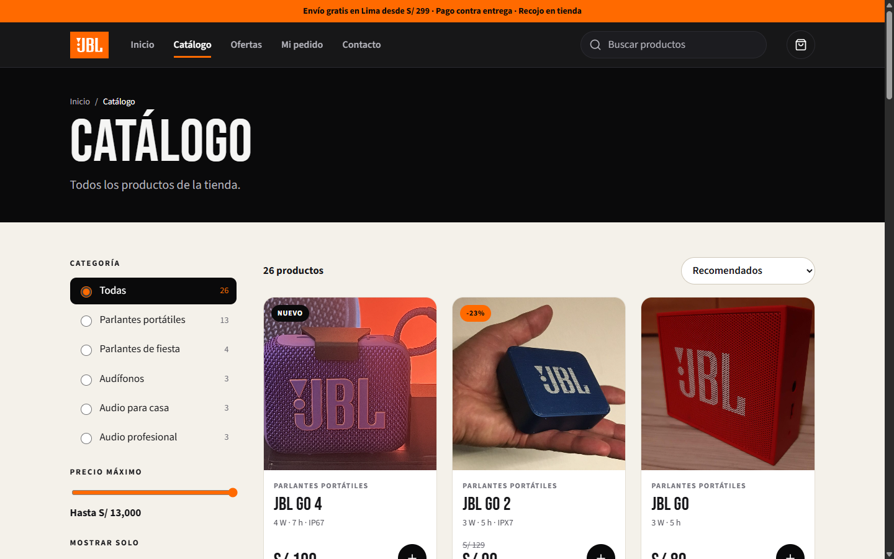
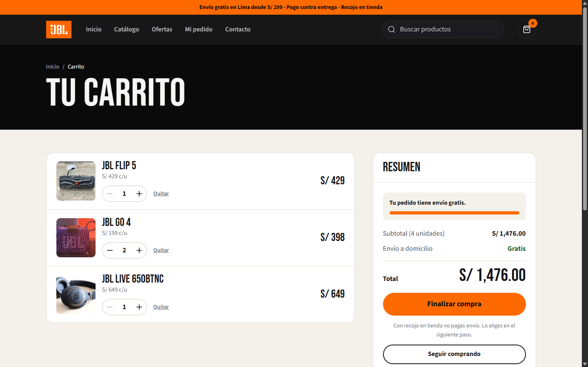
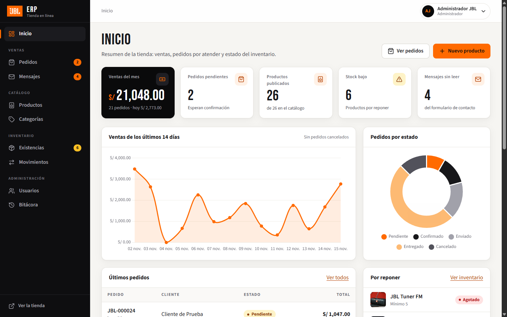
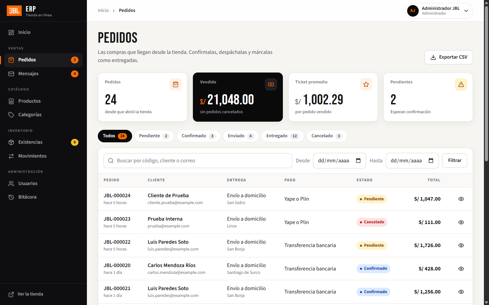

# JBL Web

Tienda de demostración de la marca **JBL** (parlantes, audífonos y equipos de audio) con un **ERP** hecho en Laravel. Proyecto del curso Herramientas de Desarrollo de la UTP: el objetivo es aplicar control de versiones, trabajo en equipo, seguimiento de incidentes, integración continua y entrega continua sobre un proyecto real.

En la tienda se recorre el catálogo, se arma un carrito, se registra un pedido y se le hace seguimiento. Desde el ERP se administran los productos, las categorías, el inventario, los pedidos, los mensajes del formulario de contacto y los usuarios del panel, con tres roles y una bitácora de acciones.

> **Proyecto académico, sitio no oficial.** La tienda no cobra ni envía nada. Los modelos y las fotografías son reales; los precios, el stock, los clientes y los pedidos son datos inventados para la demostración.

## Enlaces

| Qué | Dónde |
|-----|-------|
| Repositorio | https://github.com/Dietri-Diaz/jbl-web |
| Sitio publicado | https://jbl-web-ebon.vercel.app |
| Tablero Kanban | https://github.com/users/Dietri-Diaz/projects/1 |
| Issues | https://github.com/Dietri-Diaz/jbl-web/issues |
| Versiones | https://github.com/Dietri-Diaz/jbl-web/tags |

## El sistema en una mirada

| Parte | Qué incluye |
|-------|-------------|
| Tienda | 6 páginas: inicio, catálogo, producto, carrito, finalizar compra y seguimiento del pedido |
| ERP | 10 módulos: Inicio, Pedidos, Mensajes, Productos, Categorías, Existencias, Movimientos, Usuarios, Bitácora y Mi perfil |
| API | 4 rutas públicas: catálogo, registrar pedido, seguir pedido y enviar mensaje |
| Base de datos | 16 tablas: 8 del negocio y 8 de Laravel |
| Pruebas | 46 pruebas automáticas del ERP y un script que verifica la tienda |

## Capturas

**Tienda: catálogo con filtros**

**Tienda: carrito**

**ERP: inicio con indicadores y gráficos**

**ERP: pedidos**

Cuentas de demostración del ERP (contraseña `admin123`): `admin@jbl.pe` (administrador), `editor@jbl.pe` (editor) y `consulta@jbl.pe` (solo lectura).

## Equipo

| Integrante | Usuario de GitHub | Rol |
|------------|-------------------|-----|
| Dietri Diaz | `Dietri-Diaz` | Líder: administra el repositorio, revisa y fusiona los pull requests |
| Jorge Chuco Ortega | `jorgeo26` | Interactividad de la landing y base del ERP |
| Fabrizio Huincho Villanueva | `Alba-devjxt` | Galería de parlantes y módulo de parlantes del ERP |
| Julibeth Antonela Jaimes Daza | `Anto-Jaimes` | Secciones de tecnología, resistencia y practicidad, y pie de página |

## Páginas de esta wiki

1. **[Arquitectura](Arquitectura)**: las partes del proyecto y cómo se comunican.
2. **[Instalación y ejecución](Instalacion-y-ejecucion)**: cómo levantar la tienda y el ERP en una computadora.
3. **[Base de datos](Base-de-datos)**: modelo entidad-relación y diccionario de datos.
4. **[Flujo de trabajo](Flujo-de-trabajo)**: ramas, commits, pull requests e issues.
5. **[CI/CD](CI-CD)**: el pipeline de Jenkins y el workflow de GitHub Actions.
6. **[Despliegue](Despliegue)**: cómo llega la tienda a Vercel.

## Versiones

| Versión | Contenido | Estado |
|---------|-----------|--------|
| `v1.0.0` | Landing completa con fotografías reales | Publicada |
| `v1.1.0` | Correcciones: contenido sin JavaScript, fichas técnicas e iconos | Publicada |
| `v1.2.0` | ERP del catálogo, API y formulario de contacto | Publicada |
| `v2.0.0` | Tienda completa, ERP ampliado, seguimiento de incidentes, CI/CD y despliegue en Vercel | Publicada |
